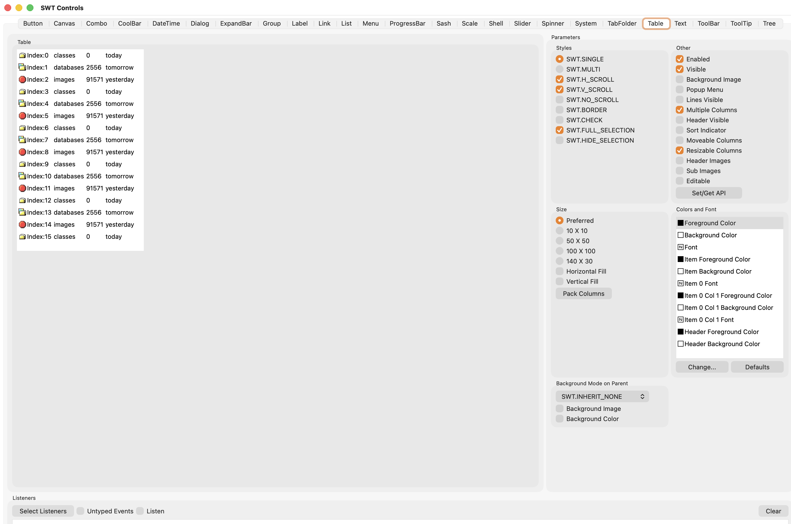
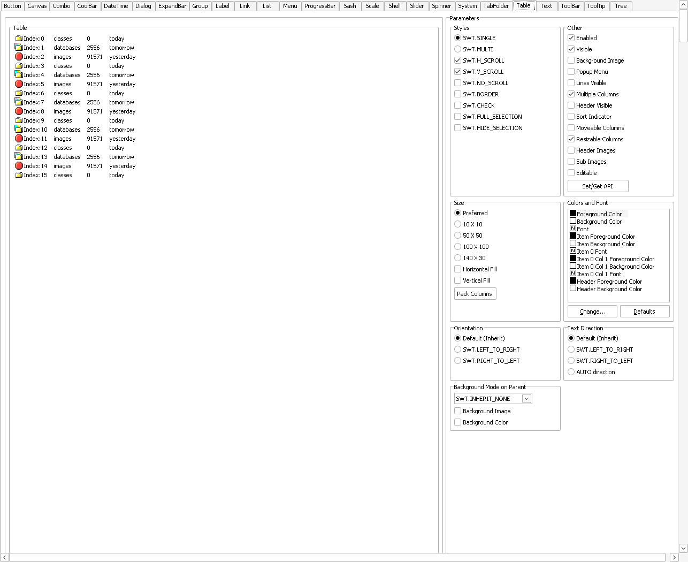
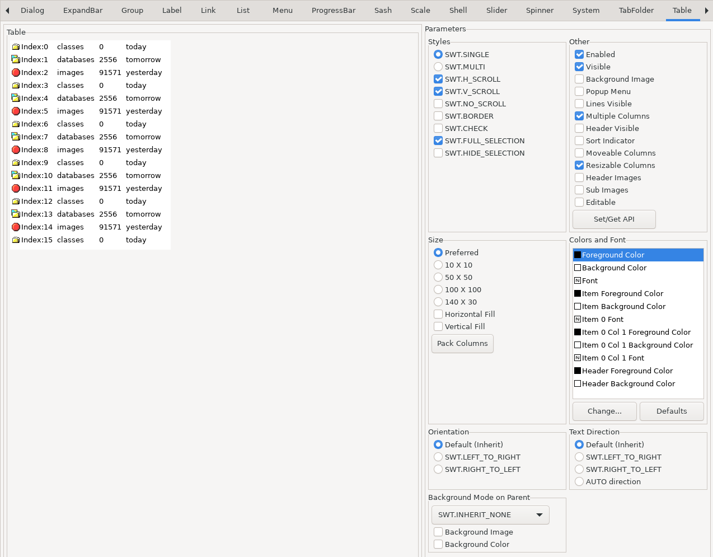

# gowt

Native GUI for Go, without cgo. Windows, tables, menus and dialogs are the operating system's own widgets: AppKit on macOS, Win32 on Windows, GTK 3 on Linux. The API is a small idiomatic Go layer (`gowt`) over Eclipse SWT, which is translated from Java to Go and bound to the OS libraries at run time.

| macOS | Windows | Linux |
|---|---|---|
|  |  |  |

The pictures above are the regression references of SWT's ControlExample (Table tab) taken by `make snap-update` on each OS (the Windows one under Wine, the Linux one in Docker with Xvfb). They show the translated SWT layer, not a program written with the `gowt` facade.

<!-- SCREENSHOTS (facade demo, to be taken with the user's consent; run each, wait 3-4 s, then capture):
macOS:   go build -o bin/gowtdemo ./cmd/gowtdemo && ./bin/gowtdemo &   then   screencapture -o -w docs/img/gowtdemo-macos.png   (click the window)
Windows: GOOS=windows go build -o bin/windows/gowtdemo.exe ./cmd/gowtdemo && /Applications/CrossOver.app/Contents/SharedSupport/CrossOver/bin/wine --bottle gowt $PWD/bin/windows/gowtdemo.exe &   then   screencapture -o -w docs/img/gowtdemo-windows.png
Linux:   make linux-run CMD='cd /src && go build -o /tmp/gowtdemo ./cmd/gowtdemo && (/tmp/gowtdemo & sleep 4; scrot -u /src/docs/img/gowtdemo-linux.png)'
glass:   go run ./cmd/glassdemo   (macOS 26)   then   screencapture -o -w docs/img/glass-macos.png
The commands were not run; the Windows and Linux ones are untested. -->

## Install

```sh
go get github.com/haiodo/gowt@latest
go mod tidy
```

Run `go mod tidy` after writing code that imports `gowt`; until then `go.mod` lists it as `// indirect`. What to expect: the module is 5.2 MB; the first build with a cold cache took about 15 s (measured on a Mac for the hello program).

Go 1.27 or newer. No C compiler and no Java. Cross-compiling works from any host: `GOOS=windows go build`. Details and per-OS requirements: [docs/install.md](docs/install.md).

## Hello

```go
package main

import "github.com/haiodo/gowt"

func main() {
	gowt.Run(func(app *gowt.App) {
		w := app.Window("Hello",
			gowt.Label("Hello, gowt"),
			gowt.Button("Quit", gowt.OnClick(app.Quit)))
		w.Show()
	})
}
```

`Run` returns an `error`; [`examples/hello`](examples/hello) is the same program with the check.

## Documentation

Start at [docs/index.md](docs/index.md). Each topic has a page and a runnable program:

| Topic | Page | Example |
|---|---|---|
| Windows and layouts | [windows-layouts](docs/windows-layouts.md) | [layouts](examples/layouts) |
| Widgets | [widgets](docs/widgets.md) | [widgets](examples/widgets) |
| Events and the UI thread | [events](docs/events.md) | [events](examples/events) |
| Dialogs and menus | [dialogs-menus](docs/dialogs-menus.md) | [dialogs](examples/dialogs) |
| Graphics and images | [graphics](docs/graphics.md) | [graphics](examples/graphics) |
| Theme and platform look | [theme-look](docs/theme-look.md) | [theme](examples/theme) |
| Icons | [icons](docs/icons.md) | [icons](examples/icons) |
| Web view | [webview-browser](docs/webview-browser.md) | [webview](examples/webview) |
| Testing with the QA driver | [qa](docs/qa.md) | [qa](examples/qa) |

SWT port, for porting SWT and JFace code (apps and the examples above do not use it):

| Topic | Page | Example |
|---|---|---|
| Using swt directly | [swt-direct](docs/swt-direct.md) | [swtdirect](examples/swtdirect) |
| JFace factories | [jface](docs/jface.md) | [jface](examples/jface) |
| SWT `Browser` | [webview-browser](docs/webview-browser.md#browser) | [browser](examples/browser) |

## What you get

- Widgets: labels, buttons, text, combo, list, table, tree, tabs, pages, split, scroll, tool bar, menus, date picker, sliders, canvas, dialogs, tray icon.
- Layouts: `VBox`, `HBox`, `Grid`, `Flow`, `Fill`, `Form`, `Pages`, with `Gap` and `Padding`.
- The system web view next to native widgets: package `webview`, and SWT's `Browser` on top of it.
- Platform look: Liquid Glass on macOS 26, Mica and Acrylic on Windows 11 22H2 and later (package `look`), light/dark following the system, system icons by name (package `icons`).
- The full SWT API in package `swt` for what the facade does not wrap, and JFace layout and widget factories in `jface`.

## Compared with Wails and Fyne

Only what the pages linked in the table say, as fetched on 2026-10-10 (the wails.io and docs.fyne.io architecture pages returned 403/404 and are not used).

| | gowt | Wails | Fyne |
|---|---|---|---|
| UI is | native OS widgets (SWT translated to Go) | web frontend: "Use any frontend technology you are already familiar with to build your UI"; "Uses native rendering engines - no embedded browser!" ([README](https://raw.githubusercontent.com/wailsapp/wails/master/README.md)) | Go GUI toolkit; how it draws widgets was not checked |
| Build needs a C compiler | no | Linux: "standard gcc build tools plus libgtk3 and libwebkit"; macOS: Xcode command line tools ([installation source](https://raw.githubusercontent.com/wailsapp/wails/master/website/docs/gettingstarted/installation.mdx)) | yes: "a C compiler" ([README](https://raw.githubusercontent.com/fyne-io/fyne/master/README.md), [Quick Start](https://docs.fyne.io/started/quick)) |
| Web view next to native widgets | yes: `webview` package | not compared (not stated in the pages checked) | not stated in the pages checked |
| Cross-compile | `GOOS=windows go build` from any host (checked from a Mac for darwin, windows, linux builds of the examples) | the build guide shows one CI job per OS ([guide source](https://raw.githubusercontent.com/wailsapp/wails/master/website/docs/guides/crossplatform-build.mdx)); it does not say anything about cross-compiling | `fyne-cross`, which needs Docker ([fyne-cross README](https://raw.githubusercontent.com/fyne-io/fyne-cross/develop/README.md): "cross compile ... using docker images") |

Not compared because it could not be confirmed from the documentation: how Fyne draws its widgets, Wails' cross-compile limits, binary sizes, performance. gowt is younger and covers fewer widgets than a mature toolkit; see the known gaps below.

## Tests

SWT's own JUnit tests, translated to Go and run per OS by `make test-swt` against `tests/expected*.txt` (a regression fails the gate):

| OS | pass | fail | skip |
|---|---|---|---|
| macOS | 3817 | 5 (+3 flaky) | 69 |
| Windows (`expected_windows.txt`, recorded under Wine) | 3728 | 70 (61 Browser tests, 9 others) (+7 flaky) | 89 |
| Linux (Docker, Xvfb) | 3840 | 2 (+1 flaky) | 58 |

3894 tests in all. On real Windows 11 arm64 (a UTM virtual machine) the run of 2026-10-22 gave 3741 passed, 64 failed, 89 skipped; the gate file was not re-recorded from it.

JFace tests: 86 pass on macOS and Windows, 85 pass and 1 fail on Linux. Counts are the `pass`, `fail`, `flaky` and `skip` lines of the expected files; every non-pass line carries a reason. The facade itself has `go test` examples and an API stability gate (`make api-check`).

## Platform requirements

| OS | Needed |
|---|---|
| macOS | 13 or later |
| Windows | 10 or later (the minimum is not verified); WebView2 Runtime for the `webview` package (preinstalled on Windows 11); visual styles and DPI awareness come with the `gowt` facade (it imports `winmanifest`); a program on `swt` alone imports `_ "github.com/haiodo/gowt/winmanifest"` itself |
| Linux | glibc (musl distributions such as Alpine are not supported); GTK 3 and an X11 or XWayland display; `librsvg2-common` on a minimal Debian or Ubuntu so that check marks draw; WebKitGTK 4.1 for `webview` |

## Known gaps

- Windows runs on a real Windows 11 arm64 (UTM virtual machine) and under Wine (CrossOver). Not checked: Mica, Acrylic and rounded corners by eye, a machine with two monitors (the VM has one display), the QA driver. Per-monitor DPI changes while running are not handled by the port itself; they use upstream SWT code and are untested.
- CI (GitHub Actions) builds and vets for darwin, linux and windows on amd64 and arm64, and runs the GUI gates (swt, jface, unit and GUI tests) on Linux under Xvfb. macOS and Windows GUI tests are not in CI; they run locally and on the VM.
- Linux: GTK 3 only.
- `Browser` does not support the Authentication event; see [docs/webview-browser.md](docs/webview-browser.md) for the rest.
- Clipboard, drag and drop and `StyledText` are in the facade (`App.Clipboard`, `DragFrom`/`DropOn`, `StyledText`). Not verified: drag and drop with a real mouse on any OS; cross-application clipboard transfer (the peer-process SWT tests are skipped); `StyledText` style rendering on macOS (upstream tests skipped). `Accessible` is a stub on all three OSes.
- macOS Table and Tree use the cell-based AppKit views.

More: [docs/platforms.md](docs/platforms.md). How the repository and the translator work: [docs/internals.md](docs/internals.md).

Contributing (build, tests, generated code, DCO sign-off): [CONTRIBUTING.md](CONTRIBUTING.md). To help test on a real Windows, Linux or Mac: [docs/field-check.md](docs/field-check.md).

License: EPL-2.0, see `LICENSE` and `NOTICE`.
