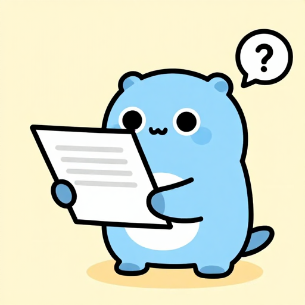

# Dialogs and menus



Example: [`examples/dialogs`](../examples/dialogs).

<br clear="right">

## Message boxes

Dialogs are methods on the parent `Window`. Settings are one struct, results are plain values.

```go
a := w.MessageBox(gowt.Message{
	Title: "Delete", Text: "Delete the file?",
	Icon: gowt.IconQuestion, Buttons: gowt.ButtonsYesNoCancel,
})
if a == gowt.AnswerYes { ... }
```

- Icons: `IconNone`, `IconInfo`, `IconWarning`, `IconError`, `IconQuestion`.
- Buttons: `ButtonsOK`, `ButtonsOKCancel`, `ButtonsYesNo`, `ButtonsYesNoCancel`, `ButtonsRetryCancel`, `ButtonsAbortRetryIgnore`.
- Answers: `AnswerOK`, `AnswerCancel`, `AnswerYes`, `AnswerNo`, `AnswerRetry`, `AnswerAbort`, `AnswerIgnore`. Closing the box with the window button gives `AnswerCancel` (or `AnswerNo`, `AnswerOK` when there is no Cancel).
- `w.Confirm(title, text) bool` is the short form for a yes/no question.

## File, folder, colour and font dialogs

| Call | Result |
|---|---|
| `w.FileDialog(gowt.FileDialog{Title, Dir, Name, Save, Multi, Filters})` | `[]string`; nil when cancelled |
| `w.DirDialog(title, dir)` | `(path, ok)` |
| `w.ColorDialog(initial RGB)` | `(RGB, ok)` |
| `w.FontDialog(initial Font)` | `(Font, ok)` |

`Multi` applies to open dialogs only; with `Save` it has no effect and one path is returned. `FileFilter{Name, Pattern}`: a pattern list is separated by `;`, e.g. `"*.png;*.jpg"`; `"*"` matches all. `Font` is `{Name, Size, Weight, Bold, Italic}`; `FontDialog` does not report `Weight`.

## Menus

```go
bar := w.MenuBar()           // on macOS this is the application menu bar
file := bar.Submenu("&File")
file.Item("&Open...", openFile, gowt.Shortcut("Cmd+O"))
file.Separator()
file.Item("&Quit", w.Close)
view.Item("Word wrap", nil, gowt.Check()).SetChecked(true)
```

- `Item(text, onClick, opts...)` appends an item; `Check()` or `Radio()` makes it a toggle. `MenuItem` has `SetText`, `SetEnabled`, `Checked`, `SetChecked`, `OnClick`.
- `&` in the text marks a mnemonic.
- `Shortcut(keys)` binds a key combination to the item and shows it next to the text: `"Cmd+O"`, `"Cmd+Shift+S"`, `"Alt+Left"`, `"F5"`. `Cmd` is Command on macOS and Ctrl on Windows and Linux; `Ctrl`, `Alt` and `Shift` are the same keys everywhere. The key is a letter, digit or punctuation mark, or `Left`, `Right`, `Up`, `Down`, `Home`, `End`, `PageUp`, `PageDown`, `Enter`, `Esc`, `Tab`, `Space`, `Backspace`, `Delete`, `Insert`, `F1`-`F12`; an unknown name panics. Text after a tab character in the item text is only shown and binds nothing. A key without a menu item is bound with `w.OnKey(keys, f)`, see [events.md](events.md#key-and-mouse-events).
- `Menu.OnShow(f)` runs just before the menu opens; refresh enabled states there.
- Context menu: `gowt.PopupMenu(widget)` returns the widget's menu; a right click opens it, `Show()` opens it by hand. It is a function, not a method.

## Tool bar and tray

`w.ToolBar()` with `Item(text, onClick)` and `Separator()`; items have `SetImage`, `SetTooltip`, `SetEnabled`, `SetChecked`.

`app.Tray(tooltip, onClick)` adds a tray icon and returns nil where the system has no tray, so check for nil. Use `SetImage`, `SetTooltip`, `Remove`.

`app.SetBadge("3")` shows a count on the application icon, as a mail app shows unread messages, and `app.SetBadge("")` removes it. macOS draws it on the app's Dock tile. Windows draws it as an overlay on the taskbar button of every window, also of windows created later with `app.Window`. Linux sends it as the count of the launcher entry, which Ubuntu Dock, dash-to-dock and KDE Plasma draw; they show whole numbers only, so other text hides the count. The dock finds the app by its desktop file, which must be named after the app name, see [packaging.md](packaging.md#linux). SWT's `app.Unwrap().GetSystemTaskBar()` differs per platform, as in SWT for Java: macOS has only the application item, `GetItemShell(nil)`, and returns nil for a window; Windows shows only window items, `GetItemShell(shell)`; on Linux the TaskBar is nil.
