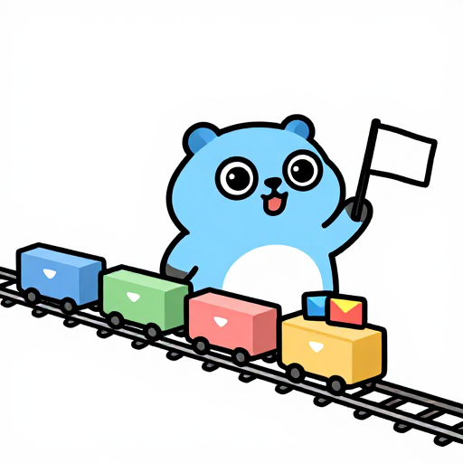

# Events and the UI thread



Examples: [`examples/events`](../examples/events), [`examples/quit`](../examples/quit) (Save changes on quit), [`examples/rows`](../examples/rows) (rows bound to state), [`examples/boundary`](../examples/boundary) (errors shown in place).

<br clear="right">

## Callbacks

Events are options of the constructor, with plain functions as handlers. One name per concept; the handler's parameter is what the widget reports:

```go
gowt.Button("OK", gowt.OnClick(ok))
gowt.Text(gowt.Hint("Search"), gowt.OnChange(func(s string) { query.Set(s) }), gowt.OnActivate(find))
gowt.Switch("Wi-Fi", gowt.Checked(true), gowt.OnChange(func(on bool) { wifi(on) }))
gowt.Scale(0, 100, gowt.Value(30), gowt.OnChange(func(v int) { volume(v) }))
gowt.List(names, gowt.Selected(0), gowt.OnSelect(func(i int) { show(names[i]) }), gowt.OnActivate(open))
gowt.Tree(gowt.OnSelect(func(n *gowt.Node) { show(n.Text()) }))
```

| Option | Widgets |
|---|---|
| `OnClick(func())` | Button; `OnClick(func(href string))` Link |
| `OnChange(f)` | Text, Combo, StyledText `func(string)`; Switch, Check/Radio Button `func(bool)`; Scale, Slider, Spinner `func(int)`; DateTime `func(time.Time)` |
| `OnSelect(f)` | Combo, List, Table, Tabs, CTabs `func(int)`; Tree `func(*Node)` |
| `OnFocus(func(bool))` | any widget: true on gaining keyboard focus, false on losing it; a container reports its own focus only |
| `OnActivate(f)` | Text `func()` (Enter); List, Table `func(int)`; Tree `func(*Node)` |

The initial state goes in options too: `Hint(s)` for Text, `Checked(b)` for Switch and Check/Radio Button, `Selected(i)` for Combo, List, Table, Tabs and CTabs, `Value(v)` for Scale, Slider, Spinner and Progress (int), for Text, Combo and StyledText (string) and for DateTime (`time.Time`).

The `OnX` methods of the same names (`text.OnChange(f)`, `table.OnSelect(f)`) add a handler to a widget that exists already, through `Ref`. Calling `OnX` again adds another listener; nothing is replaced. Menu and tool items take their callback as an argument: `menu.Item("Quit", app.Quit)`; `nil` means none.

`Window.OnClose(func() bool)` can veto closing: return false to keep the window open.

## Quitting

`app.OnQuit(func() bool)` runs before the app quits; false cancels. The question is asked on every way out except `app.Quit()`:

| Quit | How it reaches the handlers |
|---|---|
| macOS Cmd+Q, app menu Quit, Dock Quit, logout, shutdown | `applicationShouldTerminate:` sends the SWT `Close` event to the display |
| Windows logout and shutdown | `WM_QUERYENDSESSION` sends the same event (`WM_ENDSESSION` then ends the process) |
| Closing the last window (any OS) | its `OnClose` handlers, then `OnQuit` |
| Your own Quit item | `app.Unwrap().Close()` sends the same event |

Linux has no session-end path: GTK 3 without `GtkApplication` exposes none, so logout reaches the app as a signal or a killed process, not as a question.

On a quit that is not the close of the last window, each open window is asked first, in creation order, through its `OnClose` handlers. The first refusal cancels the quit and nothing after it is asked; no window closes until every answer is yes. Then the `OnQuit` handlers run, in order, and the first false cancels. A second quit request while a question is open is refused.

A handler may show a dialog: it runs on the UI thread inside the system's quit request and `MessageBox` and `Confirm` work there on every OS. On macOS the question is answered inside `applicationShouldTerminate:` (as in SWT and Eclipse), not by `NSTerminateLater`.

```go
w.OnClose(func() bool {
	if !dirty {
		return true
	}
	switch w.MessageBox(gowt.Message{Title: "Save changes?", Buttons: gowt.ButtonsYesNoCancel, Icon: gowt.IconQuestion}) {
	case gowt.AnswerYes:
		save()
		return true
	case gowt.AnswerNo:
		return true
	}
	return false
})
```

Example: [`examples/quit`](../examples/quit).

## Opening files

`app.OnOpenFiles(func(paths []string))` runs on the UI thread with the files the system or another process asks the app to open. Paths are absolute and without duplicates within one call; files that arrive in the same turn of the event loop come in one call. Several calls add several handlers. Files that arrive before the first handler (a launch by double click) are kept and given to it once it is set. A `file:` URL becomes a path; other URL schemes are ignored.

| Source | OS |
|---|---|
| Finder: double click, Open With, a drop on the Dock icon, `open -a App.app file`, at launch and while running (`application:openFile(s):` into the SWT `OpenDocument` event) | macOS |
| Command-line arguments that name an existing file or folder, delivered once after setup (Explorer and file managers start the program with the file) | all |
| A second launch that forwards its arguments to the running app, see `gowt.SingleInstance` | Windows, Linux |
| Another program calling `org.freedesktop.Application.Open` on the app's name, such as a file manager or `gio open` with `DBusActivatable=true` | Linux |

`gowt.SingleInstance(id)` is opt-in. Call it before `Run` with a reverse-DNS id; false means another instance got this process's files and this one should return:

```go
func main() {
	if first, err := gowt.SingleInstance("org.example.MyApp"); !first {
		return
	} else if err != nil {
		log.Println(err) // no session bus or a bad id: this is an ordinary extra instance
	}
	gowt.Run(func(app *gowt.App) {
		app.OnOpenFiles(func(paths []string) { open(paths) })
		...
	})
}
```

The running instance also raises its first window when a second launch arrives, with or without files. Linux uses the session bus (the id is the D-Bus name, a small client written from the D-Bus specification, no libgio call); Windows uses a Unix socket in the user's temp folder; macOS leaves it to Launch Services and the call does nothing. A missing session bus, or a malformed id, is returned as the error and the program runs without the feature (command-line files still work). Ceilings: on Windows two first launches in the same instant may both win, and a crashed instance leaves a file that the next launch replaces; on Linux the name is lost if the bus connection drops. `app.Unwrap().AddListener(swt.OpenDocument, ...)` still fires on macOS for code that uses `Unwrap`; on Linux and Windows it does not, the facade is the only path.

Associating a file type with the program and giving it a document icon is in [packaging.md](packaging.md#file-association-and-document-icon). Example: [`examples/openfiles`](../examples/openfiles).

## The UI thread rule

All widgets belong to the UI thread: the goroutine inside `gowt.Run`'s setup function and every callback. `Run` locks it to its OS thread. Touching a widget from another goroutine is a bug. Three methods are safe from any goroutine:

| Call | Effect |
|---|---|
| `app.Async(f)` | queue `f` on the UI thread and return |
| `app.Sync(f)` | run `f` on the UI thread and wait (do not call it while the UI thread waits for you) |
| `app.Quit()` | end the event loop after the current event |

After `Run` has returned the three do nothing, so a goroutine that outlives the window may still call them; `f` does not run.

`cancel := app.After(d, f)` runs `f` on the UI thread once after `d`; `cancel()` stops it (safe from any goroutine, after `f` ran and twice). `stop := app.Every(d, f)` runs `f` every `d` until `stop()`; a panic in `f` goes to `OnError` and the ticks go on. Both are UI-thread only; `stop` and `cancel` are safe from any goroutine.

```go
go func() {
	result := slowWork()
	status.Post(result) // or app.Async(func() { ... })
}()
```

## Background work: Job, Track, Jobs

`app.Job` runs work in a goroutine and tells the app about it, so a status spinner and the QA driver know when the app is busy. It models Eclipse Jobs.

```go
job := app.Job("Download report", func(ctx context.Context, p *gowt.JobProgress) error {
	p.Total(len(files))
	for _, f := range files {
		if ctx.Err() != nil {
			return ctx.Err()
		}
		fetch(f)
		p.Step(1)
	}
	return nil
}).Then(func(err error) { /* on the UI thread */ })
job.Cancel()     // cancels ctx and returns
err := job.Wait() // from a goroutine other than the UI thread: fn's error, after the Then callbacks ran

done := app.Track("Send message") // work gowt does not start: a core library's callback, your own HTTP client
core.Send(msg, func(r Reply) { app.Async(func() { show(r); done() }) })

app.Job("Sync", poll, gowt.BackgroundJob()) // perpetual work: listed, never waited for
```

- `fn` gets a `ctx` that `Job.Cancel` and the end of `Run` cancel. A panic in `fn` goes to `App.OnError` and is the error `Then` and `Wait` see.
- `Then(f)` runs `f(err)` on the UI thread after `fn` returned; called later, it still runs `f`, queued. `Job.Wait` panics on the UI thread, where it would wait for callbacks that it blocks.
- `JobProgress` has `Total(n)`, `Step(n)` and `Text(s)`; call them from the job's goroutine.
- `Track` is for external work: `done` is idempotent and safe from any goroutine. Call it after the result has reached the UI (inside `app.Async`), or a test sees the app idle too early.
- `app.Jobs()` lists the running jobs and tracks (name, `Background`, `Track`, `Started`, `Done`, `Total`, `Text`). `app.OnJobs(f)` calls `f` on the UI thread when the set or a progress changes, at most once per event-loop turn.
- `app.Pending()` counts the jobs and tracks that are not `BackgroundJob`, until their `Then` callbacks have run, and the `After` timers shorter than one second. A longer `After` and every `Every` are not counted. The QA driver's `settle` (so every `qatest` action) waits for exactly that, and on a timeout names it: `waiting: job "Download report" 4.2s, track "Send message" 1.0s, 1 timer`. How to write tests against this is in [qa.md](qa.md).

## Reactive state (package rx)

Package `github.com/haiodo/gowt/rx` keeps widgets in step with state, in the style of Svelte 5 runes. A `State` is a value you set, a `Derived` is computed from other signals, an `Effect` reruns when something it read has changed. Nothing is declared: whatever a `Derived` or an `Effect` reads with `Get` is its dependency. Widgets bind to a state through options, so the data a screen shares lives in `rx` and needs no variable per widget.

```go
count := rx.New(0)                                          // State[int], compared with ==
label := rx.Compute(func() string {                         // Derived[string], lazy and memoized
	return fmt.Sprintf("%d clicks", count.Get())
})
onlyRunning := rx.New(false)
query := rx.New("")

w.Add(
	gowt.Label("", gowt.BindText(label)),                       // the text follows the derived
	gowt.Button("+1", gowt.OnClick(func() { count.Update(func(n int) int { return n + 1 }) })),
	gowt.Button("Only running", gowt.Check(), gowt.Bind(onlyRunning)), // two-way
	gowt.Text(gowt.Bind(query)),                                // two-way; typing keeps the caret
	gowt.Button("Find", gowt.OnClick(find),
		gowt.BindEnabled(rx.Compute(func() bool { return query.Get() != "" }))))

go func() { for v := range updates { count.Post(v) } }()    // from any goroutine
```

| Call | What it does |
|---|---|
| `rx.New(v)`, `rx.NewFunc(v, eq)` | a `State`; `Set` of an equal value does nothing. `eq` nil: every `Set` notifies (slices, maps) |
| `s.Get()`, `s.Peek()`, `s.Set(v)`, `s.Update(f)` | read and subscribe, read only, write, write `f(current)` |
| `s.Post(v)` | the only call safe from any goroutine; the last value wins, one hop to the UI thread per batch |
| `rx.Compute(fn)`, `rx.ComputeFunc(fn, eq)` | a `Derived`: recomputed when read after a source changed; an equal result stops the change there |
| `rx.Effect(fn)` | runs `fn` now and again after its sources changed; returns `dispose` |
| `rx.OnCleanup(f)` | inside an `Effect` or a `Derived`: `f` runs before the next run and on dispose; inside a `Scope`: on dispose |
| `rx.Scope(fn)` | owns the effects and deriveds created in `fn`; returns `dispose` |
| `rx.Catch(fn, handle)` | a `Scope` whose effects hand a panic in a `Flush` to `handle` instead of to `Flush`'s caller; `gowt.Boundary` is built on it |
| `rx.Untrack(fn)` | reads in `fn` do not subscribe |
| `rx.Batch(fn)`, `rx.Flush()` | run the pending effects now instead of after the current event handler |
| `app.Flush()` | `rx.Flush()`, then the layouts the bindings put off (a longer `BindText` text) instead of on the next event-loop turn: for timing one update or measuring a widget right after a change |
| `gowt.Bind(state)` | option, two-way: `*rx.State[string]` Text and Combo text, `[bool]` Switch and Check Button, `[int]` Scale, Slider, Spinner value or Combo and List index (Progress one way) |
| `gowt.BindText(r)` | option: the text of a Label, Button or Link follows an `rx.Reader[string]` (a `State` or a `Derived`) |
| `gowt.BindEnabled(r)`, `gowt.BindVisible(r)` | options on any widget, `rx.Reader[bool]` |
| `gowt.Rows(list, key, fill)`, `gowt.Nodes(list, key, children, fill)`, `gowt.Items(list)` | options: one Table row, Tree node or List/Combo entry per element of an `rx.Reader[[]T]`, matched by key, see below |
| `gowt.Watch(w, r, apply)` | call `apply` with `r`'s value whenever it changes, for as long as `w` lives: the binding for what no option covers |

Rules:

- `Set` marks the dependents at once (a `Derived` read right after sees the new value), but effects and bindings run once per batch, after the current event handler returns. Code that needs the widgets updated before it continues calls `rx.Flush()` or wraps the writes in `rx.Batch`; inside an effect both only schedule the flush. Parents run before the effects they created.
- Everything except `Post` is UI-thread only. `Set` from another goroutine panics; build with `-tags rxdebug` to check `Get` as well.
- Values that change together go into one `State` (a whole poll result) and are split with `Derived`s; separate `Post`s may reach the UI thread in different batches.
- A binding is disposed with its widget. An `Effect` or `Derived` made inside an `Effect` or `Scope` is disposed with it; a top-level `Effect` lives until its `dispose` is called. A `Derived` subscribes to its sources only while an effect observes it; read elsewhere, it is recomputed after any `Set`.
- An effect that panics does not stop the others: the flush finishes, then the panic goes to `App.OnError` like one from a callback, or to the nearest `gowt.Boundary` around its widget. A failed `Derived` is recomputed on its next read. Effects that keep invalidating each other for 100 rounds panic with "rx: effects did not settle"; a `Derived` that reads itself and a `Set` inside a `Derived` panic too.
- `BindText`, like `Label.SetText`, lays the parents out again on the next event-loop turn when the text changes the widget's size, so a growing label is not cut.

### Rows bound to state

`Rows`, `Nodes` and `Items` are Svelte's keyed `{#each list as item (key)}` for a Table, a Tree and a List or Combo. The app keeps the list in one `State` (a new slice per change, `rx.NewFunc(v, nil)`) or computes it in a `Derived`; the binding keeps the widget in step:

```go
type proc struct{ pid int; name, cpu string }       // comparable: compared with == to find changed rows
procs := rx.NewFunc([]proc(nil), nil)
gowt.Table(gowt.Grow(),
	gowt.Init(func(t *gowt.TableView) { t.Column("Name", 200); t.Column("CPU", 60, gowt.Right()) }),
	gowt.Rows(procs, func(p proc) int { return p.pid }, func(r *gowt.TableRow, p proc) {
		r.SetTextAt(0, p.name)
		r.SetTextAt(1, p.cpu)
	}))
go func() { for range time.Tick(time.Second) { procs.Post(poll()) } }()
```

- A row is matched by `key`. `fill` runs for a new key and for a row whose element is no longer `==` to the one it showed; equal rows are not touched. A removed key's row goes, with its selection.
- Rows whose keys keep their order keep their native items, so selection, check boxes and scroll position stay. A key that moved is made again at its new place (`fill` runs) and keeps its selection; on a Tree it keeps the expansion and selection of its whole subtree.
- `Nodes` takes `children func(T) []T` (nil for a flat tree) and `fill(n, item, created)`: it runs after the node's children exist, with `created` true when the node is made, so the initial expansion goes there.
- The binding owns the rows of its widget: rows added or removed by hand are dropped and the list is shown again on the next change. Columns go in `Init`.
- Keys should be unique among siblings; a repeated key gets a row made again on every change. A node moved to another parent is a new node there.
- `key`, `children` and `fill` run untracked: only a change of the list itself updates the rows, so everything they show belongs in the list or is read by the `Derived` that makes it.

Cost, per change: the common prefix and suffix are compared by key; the middle goes through a key map and the longest increasing subsequence of old positions, O(n log n), and only rows outside it are made again. When more than half the rows of a level would go, the level is cleared and made again, which is what a hand-written refill costs. A change without new, removed or moved keys allocates nothing beyond the widget calls. The binding keeps per row the key, the last element and the native item; the buffers of the diff grow to the largest change seen.

Linux (GTK, arm64, Docker), 1000 rows, two columns, per change after `app.Flush()`:

| Change | `Rows` | clear and refill by hand |
|---|---|---|
| 10 rows changed | 20 µs, 75 allocs | 5.3 ms, 35108 allocs |
| 10 rows inserted | 0.13 ms, 371 allocs | 5.3 ms |
| all keys new | 5.4 ms, 35116 allocs | 5.4 ms |
| reversed | 5.3 ms, 35191 allocs | 5.3 ms |
| Tree, 100 nodes with 10 children each, 10 changed | 36 µs, 75 allocs | 5.9 ms, 47791 allocs |

Setting the texts of the 10 changed rows by hand, knowing which they are, takes 17 µs and 64 allocs.

## Errors

An error or panic in an event handler or in an `Async`, `Sync` or `After` callback does not end the program. It goes to the function set with `App.OnError`, and the event loop goes on; without `OnError` it is logged to stderr with the stack where it was raised. Toolkit errors arrive wrapped (`gowt: Widget is disposed`), so `errors.As(err, &swtErr)` works; a panic with another value arrives as `gowt: panic: <value>`.

```go
app.OnError(func(err error) { status.Set(err.Error()) })
```

A placement option the parent's layout cannot use (`GrowX` under a `Flow`, `Anchor` outside a `Form`) is reported the same way when the widget is created, naming the option, the widget and the layout; the widget keeps its natural size.

### Boundary: errors shown in place

`gowt.Boundary(children...)` is Svelte's `<svelte:boundary>`: when its children fail, they are disposed with their bindings and effects, and a fallback is shown in their place. The rest of the window keeps working.

```go
gowt.Boundary(gowt.GrowX(),
	gowt.Failed(func(err error, reset func()) gowt.Option {
		return gowt.HBox(gowt.Label("Cannot split: "+err.Error()), gowt.Button("Try again", gowt.OnClick(reset)))
	}),
	gowt.Label("", gowt.BindText(share)))  // share panics when parts is 0
```

- Caught: panics and reported errors while the children are made (constructors, `Ref`, `Init`, an option a widget cannot use, children of a widget that holds none, `Add` on a container inside), and panics in the bindings and effects of the widgets inside after a state change (`Bind`, `BindText`, `BindEnabled`, `BindVisible`, `Watch`, `Rows`, `Nodes` and `Items` with their `fill`, `rx.Effect` made in `Init`).
- Not caught: event handlers (`OnClick`, `OnChange`, ...), `Async`, `After` and `Every`. Their errors go to `App.OnError` only, as without a boundary.
- `App.OnError` gets every caught error too, once, so a log stays complete.
- `reset` disposes the fallback and makes the children again on the next event-loop turn, with the state as it is then. Without `Failed` the fallback is the message and a Retry button.
- The innermost boundary catches first. An error in a fallback goes to the boundary above.
- The options of the boundary itself (`GrowX`, `Gap`, ...) belong to its parent: an error in them is not caught by it. Its children stack as in a `VBox`.
- A window has no boundary of its own: without one, errors go to `App.OnError` and the loop goes on, as above.

`gowt.Run` returns an `error` raised while `setup` builds the window: then nothing is on screen to recover to. A runtime error in `setup` (nil dereference, index out of range) keeps panicking. Getters and setters have no per-call errors; `App.LoadImage` and `App.ImageFrom` return one because a bad file is routine.

## Key and mouse events

`Canvas` has `OnMouseDown`, `OnMouseUp` and `OnMouseMove`; `Table` and `Tree` have `OnCellClick` with the row, column, button and click count. A key combination that runs a command belongs to a menu item when there is one: `menu.Item("Back", back, gowt.Shortcut("Alt+Left"))` binds the key and shows it in the menu. Without a menu item, `w.OnKey(keys, f)` binds it in the whole window, written as for `Shortcut`:

```go
if runtime.GOOS == "darwin" {
	w.OnKey("Cmd+[", back)
	w.OnKey("Cmd+]", forward)
} else {
	w.OnKey("Alt+Left", back)
	w.OnKey("Alt+Right", forward)
}
```

The bound key does not reach the focused widget. A focused text field (`Text`, `StyledText`, `Spinner`, an editable `Combo`) keeps the combinations it types or edits with, and `f` does not run for them there:

- a character, an arrow, `Home`, `End`, `PageUp`, `PageDown`, `Enter` or `Tab`, alone or with `Shift`;
- `Backspace` and `Delete` with any modifiers;
- `Cmd+A`, `C`, `V`, `X`, `Y`, `Z` (Command on macOS, Ctrl elsewhere), with or without `Shift`;
- on macOS the arrows, `Home`, `End`, `PageUp` and `PageDown` with any modifiers, and a character with `Alt` (Option) or `Ctrl`;
- on Windows and Linux those keys with `Ctrl`, and a character with `Ctrl+Alt` (AltGr).

So `Cmd+[`, `Alt+Left` on Windows and Linux, `Esc` and `F1`-`F12` work while the user types in a field, and `Alt+Left` on macOS or a bare letter do not. There are no other key listeners and no mouse listeners on other widgets: add them on the swt object, see [swt-direct.md](swt-direct.md).

`w.OnDispose(f)` runs `f` when the widget goes away: by `Dispose`, with its parent, or when its window closes.
