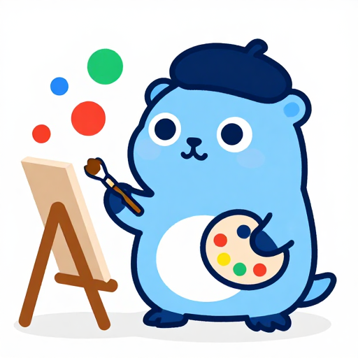

# Graphics and images



Example: [`examples/graphics`](../examples/graphics).

<br clear="right">

## Canvas and GC

`gowt.Canvas(onPaint func(g *gowt.GC), opts...)` is an empty area drawn by your callback. The callback runs whenever the system needs a repaint; draw the whole area each time. After your model changes call `canvas.Redraw()`. The canvas is double buffered. `canvas.Size()` returns the drawable width and height in points, and `g.Size()` the same inside the callback, so a chart can follow a resize and the font (margins from `g.TextSize`).

```go
var canvas *gowt.CanvasView
w.Add(gowt.Canvas(func(g *gowt.GC) {
	g.SetFill(gowt.RGB{R: 30, G: 120, B: 220})
	g.FillOval(10, 10, 100, 60)
	g.SetColor(gowt.RGB{R: 40, G: 40, B: 40})
	g.Text("hello", 20, 20)
}, gowt.Size(400, 200), gowt.Ref(&canvas)))
```

`canvas.OnResize(func(w, h int))` runs with the size `Size()` returns after layout gave the canvas a new one, and once when the first size other than 0 by 0 is known (on the next turn of the event loop if the canvas has it when you call `OnResize`). Use it for what depends on the size but is not drawing: fitting a camera or a model to the window. A size with a zero side is not reported.

The `*GC` is valid only inside the callback. There is nothing to dispose: the canvas shares the fonts `SetFont` uses with the widgets and releases them with itself. Give the canvas a size with `Size(w, h)`, or it will be small.

| Method | Draws |
|---|---|
| `SetColor(RGB)` | colour of lines and text |
| `SetFill(RGB)` | colour of filled shapes and text background |
| `SetLineWidth(w)` | outline width in pixels |
| `Line`, `Rect`, `Oval` | outlines |
| `FillRect`, `FillOval` | filled shapes |
| `Text(s, x, y)`, `TextSize(s)` | text drawn over the fill colour; measure with `TextSize` |
| `SetFont(Font)` | font of the text drawn after it, until the callback returns; empty `Name` and zero `Size` keep the canvas's, `Scale` sizes it from the system font, `Font{}` goes back to the canvas's font |
| `Image(img, x, y)` | an image |

`RGB{R, G, B}` are `uint8`. Not wrapped: paths, gradients, transforms, clipping, drawing into an off-screen image. `Unwrap()` gives the `*swt.GC` with all of them ([swt-direct.md](swt-direct.md)).

## Images

| Call | Source |
|---|---|
| `app.LoadImage(path)` | a file: PNG, JPEG, GIF, BMP, ICO, TIFF |
| `app.ImageFrom(r io.Reader)` | any reader, same formats |
| `app.ImageFromProvider(p)` | a zoom-aware provider such as `svg.NewImageDataProvider` |

Both loaders return an `error`. Use the image with `Label.SetImage`, `Button.SetImage`, `ToolItem.SetImage`, `Node.SetImage`, `TableRow.SetImageAt(col, img)`, `TrayIcon.SetImage` or `GC.Image`.

Ownership: the App owns every image, whichever call made it (the loaders, `ImageFromProvider`, `Clipboard.Image`, a drop, `icons.Get`, `icons.FromSVG`), and disposes the ones still alive when `Run` returns. `img.Dispose()` frees one earlier, for images made and dropped while the app runs. Widgets neither copy nor dispose an image, so dispose it only once nothing shows it.

## SVG

Import `github.com/haiodo/gowt/svg` to rasterize SVG at every zoom (paths, basic shapes, gradients, strokes; no text, filters or masks):

```go
img := icons.FromSVG(app, data, 24, gowt.RGB{R: 51, G: 51, B: 51})
```

`icons.FromSVG` draws `currentColor` of a monochrome icon in the given colour and caches the image per document, size and colour, so calling it again after a theme switch makes new images only for a colour not seen before. Underneath it is `app.ImageFromProvider(svg.NewImageDataProvider(data, 24, 24, "#333333"))`; for a new theme colour build a new provider. `svg.Recolor(data, color)` returns recoloured bytes. Named system icons are in [icons.md](icons.md).
