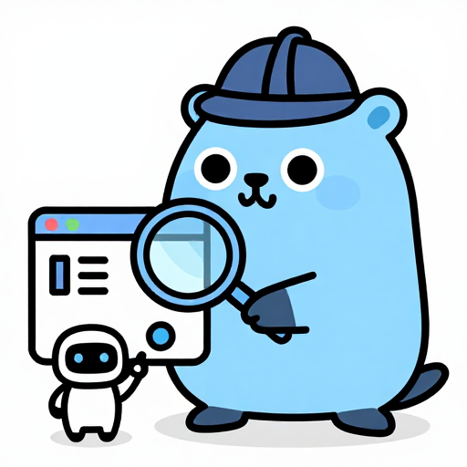

# Testing an app with the QA driver



The QA driver lets a `go test` process use your app like a user: type into fields, press buttons, select rows, wait until the app is quiet, read what is on screen. The checks are ordinary Go tests.

<br clear="right">

## How it works

- You build the app a second time with `-tags gowtqa`. That build contains a small server. `gowt.Run` starts it when the environment variable `GOWT_QA_SOCKET` is set.
- The test process (package `qa/qatest`) starts the QA build, connects to its socket and sends JSON commands: dump, find, act, settle, shot, state, jobs. On Windows, where a unix socket may not be available, the app listens on `127.0.0.1` with a random token and writes the address next to the socket path.
- Input is semantic, not synthetic. `Click` runs the control's own selection event, `Type` sends key events and sets the text one character at a time. No mouse or keyboard event goes through the operating system, so the test does not move your cursor and does not need the app to have the focus.
- On macOS and Windows the QA build opens windows without activating them, so a test run does not steal the focus from what you are doing. On Linux windows open normally.
- The build without the tag has no server and no network code. `qa.Handle` is an empty function there. `make qa-check` ([tooling/qa-check.sh](../tooling/qa-check.sh)) builds a fixture both ways and fails if the server's symbols appear in the plain build, or if `qa/qatest` links a toolkit package.
- `qatest` imports no toolkit, so the test binary does not link AppKit, Win32 or GTK. The app process opens the windows.

## Quick start

The program is [`examples/qa`](../examples/qa).

**1. Name the controls** the test needs with `gowt.ID`. It has no effect on the control and is the same in every build.

```go
gowt.Text(gowt.ID("name"), gowt.OnChange(func(s string) { name.Set(s) })),
gowt.Button("Greet", gowt.ID("greet"), gowt.OnClick(func() { greeting.Set("Hello, " + name.Get()) })),
gowt.Label("", gowt.ID("greeting"), gowt.BindText(greeting)),
```

**2. Register state handlers** with package `qa`. A handler runs on the UI thread. The handler named `"reset"` is called before every test; make it return the app to its start state.

```go
qa.Handle("reset", func(qa.Args) error { greeting.Set(""); return nil })
qa.HandleValue("greeting", func(qa.Args) (any, error) { return greeting.Get(), nil })
```

Handlers read their arguments from `qa.Args`: `Has`, `String`, `Int`, `Bool` (zero value when the key is absent or of another type) and `Decode(key, &v)`.

**3. Write `TestMain` and a test.** `qatest.Main` starts the app on first use and stops it after the last test.

```go
func TestMain(m *testing.M) {
	// build the app with -tags gowtqa into bin, see examples/qa/qa_test.go
	qatest.Main(m, bin)
}

func TestGreet(t *testing.T) {
	app := qatest.App(t) // runs the "reset" handler first

	app.Find(qa.ID("name")).Type("Ada")
	app.Find(qa.ID("greet")).Click() // actions settle before they return

	if got := app.Find(qa.ID("greeting")).Node().Text; got != "Hello, Ada" {
		t.Fatalf("greeting is %q", got)
	}
}
```

Every `qatest` method fails the test with `t.Fatalf`; none returns an error. `Main` takes the binary path and extra arguments for the app.

**4. Build and run.** The example builds the app in `TestMain` with `go build -tags gowtqa`, and opens windows only when `GOWT_GUI_TEST` is set; its tests skip otherwise.

```sh
GOWT_GUI_TEST=1 go test ./examples/qa
```

`GOWT_GUI_TEST` is a convention of the example and of gowt's own tests, not something `qatest` reads. If your `TestMain` builds nothing and the binary comes from elsewhere, pass its path to `qatest.Main` as is.

### Environment

| Variable | Set by | Meaning |
|---|---|---|
| `GOWT_QA_SOCKET` | `qatest` | Socket path. The QA build listens only when it is set; without it the build behaves like a normal one. |
| `GOWT_QA_DATA` | `qatest` | A private empty directory for the app's files. The toolkit does not read it; your app must, via `os.Getenv(qa.EnvData)`, to keep tests away from the user's data. |
| `GOWT_QA_ARTIFACTS` | you | Directory for screenshots and failure files. Without it a temp directory is made per call. |
| `GOWT_QA_KEEP` | you | Any value keeps the temp directory of the run (socket, data, `app.log`) after the app stops. |
| `GOWT_QA_APP` | you | Not read by `qatest`. [qa/qatest/e2e_gui_test.go](../qa/qatest/e2e_gui_test.go) uses it to take a prebuilt binary instead of building one; do the same in your `TestMain` if you need it. |

## Selectors

A `qa.Selector` says which control. An empty field matches anything; all given fields must match.

| Constructor | Matches |
|---|---|
| `qa.ID("send")` | the control created with `gowt.ID("send")` |
| `qa.Class("Button")` | the swt class name from the dump: `Button`, `Text`, `Table`, `TableItem`, ... |
| `qa.Text("Save")` | text equal to the node's `Text` or `Value` |
| `qa.Text("~Sav")` | a text that starts with `~` matches a part of `Text` or `Value`. A literal text cannot start with `~`. |
| `sel.In(parent)` | narrows `sel` to the descendants of the one control `parent` picks |

```go
qa.Class("TableItem").In(qa.ID("contacts"))        // rows of one table
qa.Text("~Ada").In(qa.ID("contacts"))              // the row with "Ada" in its first cell or in the other cells
qa.ID("ok").In(qa.ID("settings"))                  // a control inside the one named "settings"
```

Matching is strict:

- An action needs exactly one match. Zero or several fail with the count and the path, class and text of each match: `qatree: click on {class=Button}: 2 controls match: 0/Composite.0/Button.0 (Button "Save"), ...`.
- `In` needs its parent to match exactly one control, otherwise the error says `within ... matches N controls`. The parent itself is not a candidate.
- `Element.Nodes()` returns an empty list for no match, `Exists()` reports it, and `Node()` fails unless there is exactly one.
- A selector is looked up again on every call, so an `Element` kept in a variable never goes stale.

### Reading the dump

`app.Dump()` returns one tree per open window; windows that are hidden or closed are not in it. When a selector does not match, print the dump (a failed test saves it as `dump.json`) and copy what you see.

| Field | Meaning |
|---|---|
| `ID` | the `gowt.ID`, also set on items that are widgets: table, tree and tab items, tool items, menu items |
| `Class` | swt class: `Shell`, `Button`, `Label`, `Text`, `Table`, `Tree`, ... |
| `Text` | the label or title; for a `Text` field its hint (the message), not its content |
| `Value` | the content of `Text`, `StyledText` and `Combo`; the number of `Scale`, `Slider`, `Spinner`, `ProgressBar`; the selected item of a `List`; the other cells of a table row, tab separated |
| `Enabled`, `Visible` | already combined with the parents, so false means the user cannot reach it. Controls on a TabFolder page that is not selected, and children of a collapsed tree item, are not visible. |
| `Focused` | this control has the focus |
| `Bounds` | `[x y w h]` in the coordinates of its window |
| `Checked` | set for check, radio and toggle buttons, check items of a table, tree, tool bar and menu |
| `Selected` | selected indices in a `List`, `Combo`, `Table`, `Tree` (position among all items in pre-order, collapsed ones too), `TabFolder` |
| `Path` | position in the tree such as `0/Composite.1/Button.0`; stable within one dump |

Items have their own classes:

| Class | Where | `Text` |
|---|---|---|
| `TableItem` | `Table` | first cell; the rest are in `Value` |
| `TreeItem` | `Tree`, nested | first cell |
| `ListItem`, `ComboItem` | `List`, `Combo`; swt has no item objects, so these have no `ID` | the entry |
| `TabItem`, `CTabItem` | `TabFolder`, `CTabFolder` | tab title |
| `ToolItem` | `ToolBar` | item text |
| `MenuItem` | the window's menu bar, nested for submenus | the title without the mnemonic `&`; an accelerator that swt keeps in the text after a tab (`Run\tCtrl+R`) is in `Value` |

## Actions

```go
app.Find(qa.ID("composer")).Type("hi")   // replaces the text of a Text, StyledText or editable Combo; sets the number of a Spinner
app.Find(qa.ID("send")).Click()          // button, check, radio, link, tool item, menu item, row, tab
app.Find(qa.ID("remember")).Check(true)  // check box, radio, toggle, check item of a table or tree row
app.Find(qa.ID("rooms")).Select(2)       // item by index in a list, combo, table, tree or tab folder
```

| Action | Notes |
|---|---|
| `Click` | A button gets its selection event. Check and radio buttons toggle (a radio button is selected). A link reports its `href`. A `TableItem`, `TreeItem`, `TabItem`, `CTabItem`, `ListItem` or `ComboItem` is selected. Click on a menu item that opens a submenu fails. |
| `Type(text)` | Gives the field the focus unless it has it already, clears the field, then for each character sends `KeyDown` (a listener may veto it), sets the text with the character added, sends `KeyUp`. So `OnChange` runs once per character. A read-only field fails. In a Spinner the text is a number (`"42"`, `"1.5"` for a spinner with one digit, `"-3"` when the minimum is below 0); the value follows each character, is clamped to the range, and any other text fails. |
| `Check(on)` | Does nothing when the state already is `on`. A radio button cannot be cleared; select another one. A control without a checked state fails. |
| `Select(index)` | The index counts the items in the dump's order; for a tree, in pre-order. |

The `act` command also accepts per-call `settle` and `timeout_ms`; `qatest` has no method for them, use `app.Call("act", ...)`.

Before an action runs the driver checks that the user could do it. It refuses, with the reason in the error, when the control or an ancestor is not visible or is disabled, when its window is closed, or when an application-modal or system-modal window is open above it.

Every action settles before it returns (see Waiting), so the next line of the test sees the result.

More actions:

| Call | Does |
|---|---|
| `SelectText("b")` | Selects the item with this text in a list, combo, table, tree or tab folder. |
| `Activate()` | Double click or Enter: a List, Table or Tree row (selected first), the selected row of the control, a single-line Text, a push Button, a window (its default button). `OnActivate` runs once. |
| `Expand()`, `Collapse()` | A Tree row. The Expand event runs first, so a lazy tree builds its children; a lazy node needs a placeholder child. |
| `Focus()` | Gives the control focus (`OnFocus`); nothing happens when it has it. On macOS the app stays inactive and no window is brought to the front. |
| `Close()` | Closes a window like its close button; `OnClose` may veto. |
| `Key("Mod+K")`, `app.Key(...)` | A key or combo: `Enter`, `Esc`, `Shift+Tab`, `F5`, `Mod+K`. `Mod` is Cmd on macOS, Ctrl elsewhere. `app.Key` goes to the focus control. |
| `ScrollTo(sel)`, `ScrollBy(dx, dy)`, `ScrollIntoView()` | Scroll a ScrollView to a control, by pixels, or the ScrollView holding this control. `OnScroll` runs. |
| `ScrollEvent(qa.ScrollEvent{...})`, `Pinch(qa.PinchEvent{...})` | Scroll and pinch events for a gfx view (`gfx/view`), see Scroll and pinch. |
| `ClickAt(x, y)`, `DoubleClickAt(x, y)`, `RightClickAt(x, y)`, `DragTo(x, y, toX, toY)`, `Pointer(qa.PointerEvent{...})` | Mouse events at a point of a gfx view or of any control, see Mouse. |

| `DragDropTo(target)`, `DragDropToAt(target, x, y)` | A drag and drop to a control or row, see Drag and drop. |

`Key`: a menu item with that accelerator runs and the control sees nothing, as with macOS key equivalents. Otherwise `Window.OnKey` filters and the control's key listeners get KeyDown, then KeyUp; Enter that was not vetoed also activates. A key does not type text; use `Type`. `Type` and `Key` on a control that already has the focus do not ask for it again, so an inline editor (`view.Edit`), which commits when its field loses the focus, stays open; to a control that has not the focus, they move it first, as a click would. In a Spinner, Up and Down step by the increment, PageUp and PageDown by the page increment (clamped, or wrapped with `WRAP`), and Modify and Selection run.

`app.Eventually(timeout, func() (observed any, ok bool))` polls for what settle cannot see (a server push, a file); the error shows the last observed value.

## Scroll and pinch

`Element.ScrollEvent` and `Element.Pinch` hand one scroll or pinch step to a `gfx/view` view, through the router its native events use, so `View.OnScroll` and `View.OnMagnify` run and, when they do not take the event, the camera pans or zooms. No OS event is sent, the window needs no focus, and the camera has moved when the call returns (the scroll smoothing is skipped: the whole delta is applied at once). Any other control fails with `takes no scroll or pinch events`.

```go
v := app.Find(qa.ID("canvas"))
v.ScrollEvent(qa.ScrollEvent{DX: -30, DY: 20, Precise: true, Phase: "changed"}) // trackpad: points
v.ScrollEvent(qa.ScrollEvent{DY: 1})                                          // wheel: one line
v.ScrollEvent(qa.ScrollEvent{DY: 40, Precise: true, Mods: "Mod"})             // Cmd or Ctrl and scroll zooms
v.Pinch(qa.PinchEvent{X: 100, Y: 100, Magnification: 0.5, Phase: "changed"})  // 50 percent more, about (100, 100)
```

`X`, `Y` are in the control's coordinates (the default 0, 0 is its top left corner). `Phase` and `Momentum` are `""` (a wheel), `"mayBegin"`, `"began"`, `"changed"`, `"ended"` or `"cancelled"`. `Mods` is `Shift`, `Alt`, `Ctrl`, `Cmd` (macOS) or `Mod`, joined by `+`. Without `Precise` the deltas are wheel lines (16 points each), with it points. Read the result from the camera, for example through a `qa.HandleValue` that returns `v.Compositor().Camera()`.

## Mouse

`Element.ClickAt`, `DoubleClickAt`, `RightClickAt` and `DragTo` send a press, moves and a release at a point, `Pointer` one `qa.PointerEvent` (`Kind` `"down"`, `"move"`, `"up"`, `"click"`, `"doubleclick"` or `"drag"`; `Button` 1 left, 2 middle, 3 right; `Count`; `Mods`). The point is in the control's coordinates.

- A `gfx/view` view gets them through its router, as native events arrive: `OnPointer` sees `Pointer` with the node under the point, `View.Drag` and an inline editor behave as with the mouse. A press over a control placed on the view (`View.Overlay`, `View.Edit`) fails, since that control would take it.
- Any other control gets the listener events `MouseDown`, `MouseMove`, `MouseUp` (and `MouseDoubleClick` for the second press), so `CanvasView.OnMouseDown` and the like run. Controls that react to a click by themselves (a button) do not: use `Click` for them.
- A press focuses the control without activating the window. The view's own focus on press (`SetFocus`) needs an active window, which a QA run does not have, so the driver gives the focus the way `Focus` does. To send keys to a view, press it first, then `app.Key`; or call `Focus()`.

```go
v := app.Find(qa.ID("canvas"))
v.DoubleClickAt(150, 150)                      // opens the inline editor of the node there
app.Find(qa.ID("title-edit")).Type("Renamed")  // keeps the focus, so the edit is not committed
app.Key("Enter")                               // commits
v.DragTo(10, 10, 90, 50)
```

## Context menus and popovers

- A control with a context menu (`gowt.PopupMenu`) has a `Menu` node in the dump, with `MenuItem` nodes below it (submenus nested). Find an item through its control: `qa.Text("Rename").In(qa.ID("canvas"))`. `Click` runs it as a right click and a choice would: the menu's `OnShow` runs first, so the app refreshes the items, then the item's own selection event. A disabled item is refused after `OnShow`. A menu with no items is shown to the app first (its `OnShow` runs, once per action), so items added there are in the dump and `Find` sees them; `RightClickAt` on a control with a context menu does the same for that menu, with no native menu and no tracking loop. The menu is always listed, as if open; a menu that is not open has no position, so its nodes have no `Bounds`.
- An open popover (`Window.Popover`) is a root of the dump with class `Popover`, next to the window's own tree, with the popover's widgets below it. Its `Bounds` are in the popover's own coordinates. Give the popover `gowt.ID` to find it by name. `Close()` on the root closes it as a click outside does; its `OnClose` runs. `Esc` (`app.Key("Esc")` or `Key("Esc")` on a control of the popover) goes to the popover that is open: its `OnEscape` handler runs, and unless that returns true the popover closes. On macOS the popover is an `NSPopover` and its window is not a normal one; the dump still lists it.
- `app.Shot` includes the open popovers of the window: each is captured on its own and drawn into the window's image at its place; the image grows when a popover reaches past the window. On Windows the shot then does not bring the window to the front, which would close the popover. Which window a shot takes: `app.Shot` the first one; `app.ShotOf(name, sel)` the window that holds the control `sel` picks (for a control in a popover, the window it belongs to), the way to shoot a Preferences or a second document window; `app.ShotTitle(name, title)` the first window with that title; `app.ShotWindow(name, index)` the window at that position of the dump, popovers not counted. The order of the windows is the toolkit's and on Windows it is the stacking order, which a capture changes: use `ShotOf` or `ShotTitle` there.

## Drag and drop

`Element.DragDropTo(target)` drags this control or row onto `target` (a control or a row) when both have a `gowt.DragFrom` and a `gowt.DropOn`. The source row is selected first, as the mouse press before a drag selects it; on a Tree or Table without a row in the selector, the selected row is dragged. The point is the middle of the row or control; `DragDropToAt(target, x, y)` takes the drop point in the target control's coordinates, for a canvas.

```go
app.Find(qa.Text("apple").In(qa.ID("src"))).DragDropTo(app.Find(qa.Text("crate").In(qa.ID("dst"))))
app.Find(qa.Text("pear").In(qa.ID("src"))).DragDropToAt(app.Find(qa.ID("canvas")), 100, 60)
```

What runs is SWT's own drag logic, without an OS drag session: the `DragDetect` event on the source control (its other listeners see it), `DragStart` (`Drag.OnStart` may cancel), `DragEnter`, `DragOver` (`Drop.Over`), `DragLeave`, `DropAccept`, `DragSetData`, `Drop` and `DragEnd` (`Drag.OnDone`). The types are those the source's `Transfer`s offer and the target's accept; the operation is chosen by the rules of the platform's `DropTarget` for a plain drag with no key held; the data goes through `javaToNative` of the source and `nativeToJava` of the target. The call returns when the drop is done. Nothing depends on the window being active or on the pointer.

Differences from a real drag, the same on all three OSes: `DragOver` runs once, not for each mouse move; there is no drag image, cursor feedback or auto-scroll; on macOS a Tree and a Table take the generic path, not the `NSOutlineView` data source calls; a Windows `DragEnter` gets the data types from the source's `Transfer`s, not from `IDataObject.EnumFormatEtc`. The refusal cases are errors: no `DragFrom` on the source, no `DropOn` on the target, a point outside the control. A drag nobody accepts (`Over` returns false, `OnStart` returns false) is not an error; read it from the app's own state (`OnDone` gets `OpNone`).

Real pointer drags are checked by `TestDndRealMouse` in the repository root (`xdotool` on Linux, `SendInput` on Windows, `CGEventPost` on macOS, which needs the Accessibility permission and skips without it).

## Dialogs

In a QA build `MessageBox`, `Confirm`, `FileDialog`, `DirDialog`, `ColorDialog` and `FontDialog` are not shown. Queue the answer before the action:

```go
app.Answer(qa.Dialog{Kind: "confirm", Reply: true})
app.Find(qa.ID("delete")).Click()
d := app.Dialogs()[0] // Kind, Title, Message, Buttons, Dir, Filters ...
```

| Kind | Reply |
|---|---|
| `message` | button name: `"OK"`, `"Cancel"`, `"Yes"`, `"No"`, `"Retry"`, `"Abort"`, `"Ignore"` |
| `confirm` | `true` or `false` |
| `file` | a path, or a list of paths for a `Multi` open dialog |
| `dir` | a path |
| `color` | `"#rrggbb"` |
| `font` | `gowt.Font` fields, e.g. `map[string]any{"Name": "Menlo", "Size": 12}` |

`Cancel: true` answers as a dismissed dialog. Answers are used in order per kind. A dialog with no answer gets Cancel and fails the action that opened it, so a test never hangs on a native dialog. `App(t)` clears answers and the record.

## Waiting

An action returns after `settle`; call `app.Settle()` yourself after something the test did not start, for example a timer. Settle loops until all of these hold:

- the UI queue is empty: pending `app.Async` and `rx` effects, and window relayouts;
- no `app.Job` or `app.Track` is running, and its `Then` callbacks have run;
- no `app.After` timer shorter than one second is waiting;
- two dumps taken in a row are equal.

It does not wait for jobs started with `gowt.BackgroundJob()`, for `app.After` of one second or more, or for `app.Every`.

Settle gives up after 5 seconds. The error says what it was still waiting for:

```
settle: not quiet after 5s: waiting: job "Download report" 4.2s, track "Send message" 1.0s, 1 timer
settle: not quiet after 5s: waiting: nothing queued; the dump kept changing
```

The second form means the UI never stopped changing, for example a clock label. Stop such updates in the QA build or in `reset`.

Tests should not sleep. `app.Eventually` (see Actions) is for the rare condition outside the app; for the app's own work, make the app tell the driver about it:

| Work | Wrap it in | Waited for |
|---|---|---|
| Your goroutine: a request, a file scan | `app.Job(name, fn)`; update the UI in `.Then(...)` | yes |
| Work gowt does not start: a library callback, your own HTTP client | `done := app.Track(name)`; call `done()` inside `app.Async` after the result is shown | yes |
| A poll or sync loop that never ends | `app.Job(name, fn, gowt.BackgroundJob())` | no, but listed |

```go
app.Job("Load greeting", func(ctx context.Context, p *gowt.JobProgress) error {
	time.Sleep(time.Second) // a slow request
	return nil
}).Then(func(error) { greeting.Set("Loaded") })
```

The click that starts this job returns after the job and its `Then` have finished, so the test reads the result at once. A bare `go func()` that calls `app.Async` is invisible to settle: wrap it. Details of `Job`, `Track` and `Jobs` are in [events.md](events.md#background-work-job-track-jobs).

`app.Jobs()` returns the running jobs and tracks, background ones included, as `[]qa.Job` (`Name`, `Background`, `Track`, `ElapsedMS`, `Done`, `Total`, `Text`).

## State and isolation

- One app process serves a whole test package. The process starts at the first `qatest.App(t)` and stops after the last test. Tests of one package must not run in parallel.
- `qatest.App(t)` calls the `"reset"` handler before each test. Without one the state carries over from the previous test. Your `reset` should close extra windows, clear models and set inputs back; it does not restart anything.
- `qatest.RestartPerTest = true`, set in `TestMain` before `Main`, starts a fresh process for every `App(t)` instead. It is slow and gives a clean slate, including the data directory.
- The data directory is `GOWT_QA_DATA`, a new empty temp directory per process, removed when the app stops unless `GOWT_QA_KEEP` is set. An app that stores files in the user's directory will leave test data there; read `qa.EnvData` and use it when set.
- If a command times out or the connection breaks, the session is marked broken, the test fails, and the next `App(t)` starts a new process.
- `app.State(name, key, value, ...)` calls a handler from the test and returns its JSON result: `app.State("greeting")`, `app.State("chat", "room", "general")`. Handlers run on the UI thread; use them to read or set model state that has no control on screen, or to seed data.

## Screenshots and artifacts

- `app.Shot("name")` saves `name.png` of the first window, open popovers included, and returns the path. For another window call `app.Call("shot", map[string]any{"window": 1})`. Before the capture the shot asks every `gfx/view` view in that window for a frame and waits, for at most 3 s, until one came and no tile is queued or being drawn, so a camera change made just before shows. A view that animates all the time is captured as it is after 3 s. On macOS the view capture leaves out CALayer content, so the shot draws the view's tile layers over it from the compositor's own images (no window server, no screen recording permission).
- A failed test saves the following into `$GOWT_QA_ARTIFACTS/<test name>` (a new temp directory when the variable is unset; the path is logged):

| File | Content |
|---|---|
| `failure.png` | screenshot of the first window |
| `dump.json` | the full control tree |
| `commands.log` | every command sent, with arguments, result or error, and time taken |
| `app.log.tail` | the last 4 KiB of the app's stdout and stderr |

If the connection to the app is already lost, the screenshot and the dump are skipped and the log files are still written.

## Limits

- The search field of a native toolbar (`look.ToolbarItem.OnSearch`, macOS) is in the dump as a `Text` with the item's `ID`, the title as `Text` and the field's text as `Value`, as the search `Text` of the bar on Windows and Linux. `Type` sets the text and runs `OnSearch` once with it; `Key("Enter")` runs it with the text; `Key("Esc")` clears the field, runs it with "" and folds the field; `Focus` expands the field. No other key reaches it.
- Not in the dump: the other items of a native toolbar set with `look.SetToolbar` (NSToolbar), column headers of a table, the tray, the macOS application menu (the window's own menu bar object is walked), and the content of a `Browser` or web view. Native dialogs (message boxes, file choosers) are not in the dump either; see Dialogs.
- A modal dialog the facade does not route (one opened through `Unwrap()` or a custom modal `Shell` loop) blocks the UI thread. Commands that need it fail after 10 seconds with `the UI thread did not answer in 10s (a modal dialog?)`.
- There is no true headless mode on macOS and Windows: the app opens real windows on the desktop, without taking the focus. On Linux run the test under Xvfb (`xvfb-run go test ...`). The gowt stand for Linux is Docker with Xvfb.
- The QA driver ran on the Windows 11 arm64 virtual machine (the `qa/qatest` suite, pointer, context menu and popover tests included), not on a machine with the QA build in daily use; under CrossOver/Wine it was not run. See [platforms.md](platforms.md).
- Input is semantic. A click, also `ClickAt`, is delivered to the control even when another control covers it on screen, and a text is typed into a field the user could not focus. A test can pass where a real user would be blocked. Check overlaps with `Bounds` and by eye with a screenshot.
- `Type` sends characters without key modifiers, input methods or shortcuts.
- Pixel output is not compared; `Shot` is for you to look at.
