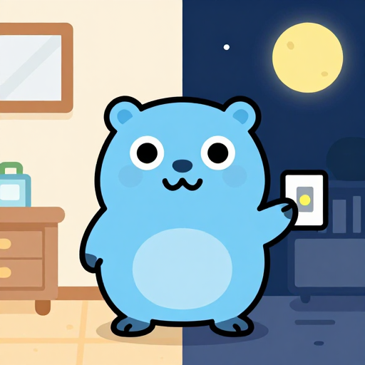

# Theme and platform look



Example: [`examples/theme`](../examples/theme).

<br clear="right">

## Light and dark

`gowt.Run` makes the app follow the system theme. Two calls expose it:

```go
dark := app.Dark()                       // UI thread
app.OnThemeChange(func(dark bool) { })   // runs after widget colours were refreshed
```

How the theme is read: macOS `NSApp.effectiveAppearance`, Windows the apps theme setting, Linux the `color-scheme` value of xdg-desktop-portal. Where each OS stands:

| OS | What follows the theme |
|---|---|
| macOS | the whole UI |
| Windows | the title bar; content stays light unless you call `look.SetDarkContent(app, true)` before creating windows (scroll bars, tables, trees, buttons; it uses undocumented uxtheme exports and does not switch live) |
| Linux | the theme and accent colour come from the portal; this was not verified against a live portal |

A widget colour can follow the theme by itself: give `Foreground`, `Background`, `SetForeground` or `SetBackground` an `Adaptive{Light, Dark}` instead of an `RGB`, and the facade applies the other colour on a switch, before the `OnThemeChange` callbacks run. A background on a container (Window, a box, Group, Pages, Scroll, Split) shows behind the labels and boxes inside it (SWT `INHERIT_DEFAULT`); text fields, lists, tables and buttons keep the native one.

```go
surface := gowt.Adaptive{Light: gowt.RGB{R: 255, G: 255, B: 255}, Dark: gowt.RGB{R: 30, G: 31, B: 34}}
gowt.VBox(gowt.Background(surface),
	gowt.Label("Containers", gowt.Typeface(gowt.Font{Scale: 1.15, Weight: gowt.Semibold})))
```

`gowt.SecondaryText` is the system colour of secondary text, for the second line of an empty state or a value next to its label. It is a `Paint` like `Adaptive` and is read again on a theme switch.

| OS | Source |
|---|---|
| macOS | `secondaryLabelColor` for the app's appearance, flattened over `windowBackgroundColor`: SWT text colours are opaque, and SWT's own `COLOR_WIDGET_DISABLED_FOREGROUND` there is a selection background |
| Windows | `COLOR_GRAYTEXT` (SWT `COLOR_WIDGET_DISABLED_FOREGROUND`); system colours do not follow the apps theme, so under `look.SetDarkContent` it is expected to stay the light-theme grey (not checked) |
| Linux | the insensitive label colour of the GTK theme (SWT `COLOR_TITLE_INACTIVE_FOREGROUND`) |

On a `Section` card the label takes the card colour behind its text, while the macOS text colour is mixed over the window colour, a few percent off the card. Only secondary text has a system colour: no tertiary text, separator or accent `Paint`, since `Separator()` and `Link` already draw the native ones and `GC` takes `RGB`.

```go
gowt.Label("Open a .cpuprofile, or drop one on this window", gowt.Foreground(gowt.SecondaryText))
```

`GC` colours and images are drawn for one theme: redraw the canvas and ask `icons.Get` or `icons.FromSVG` again in `OnThemeChange`.

## Package look

`github.com/haiodo/gowt/look` holds options for the platform's own appearance. Every call does nothing on a system without the feature, so it is safe to call everywhere.

| Call | Effect |
|---|---|
| `look.SetBackdrop(w, look.BackdropNone / BackdropTranslucent / BackdropGlass)` | window material. macOS: blurred material or Liquid Glass (26+). Windows 11 22H2 (build 22621) and later: Acrylic (`BackdropTranslucent`) or Mica (`BackdropGlass`); older builds keep the opaque window. Linux ignores it |
| `look.SetGlass(container, true)` | Liquid Glass surface behind a `Panel`, `Window`, `Group`, `Split` or `CoolBar`. Its content shows the glass through as a `SetSidebar` sidebar does, also the controls created later; lists, tables and trees get the source-list style. macOS 26; older macOS shows a blurred material, other systems nothing. A multi-line `Text` inside draws no background of its own; a single-line one keeps its field |
| `look.SetMaterial(container, true)` | the material of the `SetSidebar` sidebar and the `SetInspector` inspector, flush with the container's edges and with square corners, for a pane such as a code panel under a canvas in a `Split`; `SetGlass` gives a rounded card instead. macOS 26: the inspector's edge-to-edge Liquid Glass, as the panel glass of `SetGlass` with radius 0, clipped to the container (no shadow past its edges); WWDC25 session 310 names edge-to-edge glass for panes alongside the content and calls the legacy `NSVisualEffectView` sidebar material unnecessary on glass. Older macOS: the `NSVisualEffectView` the sidebar and inspector fall back to (under-window background, behind-window blending). The container and the controls under it stop painting their own background, as with `SetGlass`. Windows: the Fluent window background (Layer, F3F3F3 light, 202020 dark) the sidebar and inspector panels have, as the container's own background, so it shows also on content the app coloured. Linux: the theme's window background (`COLOR_WIDGET_BACKGROUND`), set again on a theme switch. On Windows and Linux the controls inside keep their own background: give a `StyledText` `gowt.NoBackground()`. In a `Split`, the sash beside the container draws a hairline in the separator colour down its middle, the thin divider of an `NSSplitView` (on every system). Glass refracts only what lies behind it in the window: beside a canvas in a `Split` that is the window background, so the pane reads as a flat light surface, as the inspector does; over a coloured panel the colour shows through (`TestMaterialShowsThrough`). Example: [`examples/materialpanel`](../examples/materialpanel) |
| `look.SetGlassRadius(container, r)` | Corner radius in points of that glass, 12 by default; `look.Capsule` is half the shorter side, set again on every resize. It may come before `SetGlass`. A field that grows over several lines wants a fixed radius of half its one-line height (the iPad composer does that): `Capsule` would turn a tall field into an oval. No-op outside macOS |
| `look.GlassButton()` | option for a push button: glass bezel on macOS 26 (rounded rectangle; with `gowt.Circle()` a circle, in either order; a `gowt.Borderless()` button stays borderless). AppKit draws the glass only for a view class without `drawRect:` and a plain `NSButtonCell`, so the button moves to the `SWTGlassButton` class and a plain cell (title, image, font, target, action and the default-button state are copied): it sends no `Paint` event and has no SWT bezel drawing. A glass circle is clipped to its circle through the button's layer, since macOS 26.5 draws a darker square behind it otherwise. Pressed and focus states are AppKit's |
| `look.SetGlassBorder(container, on)` | Hairline around the glass of `SetGlass`: 1 device pixel (`1/backingScaleFactor` points, 0.5 on Retina) of `NSColor.separatorColor`, following the corner radius, on the glass view's own layer (`borderWidth`, `borderColor`), under the controls. On a white content panel a glass capsule is otherwise almost invisible. A `CALayer` keeps the `CGColor` it was given, so the colour is resolved under the view's `effectiveAppearance` and set again on `SWT.Settings` (the system appearance changed). A new radius (`SetGlassRadius`, `Capsule`, every resize, so `AutoGrow` too) sets the stroke again. It may come before `SetGlass`; the flag is an associated object of the panel view. A panel in a `SetGlassGroup`, macOS before 26 and other systems: no stroke
| `look.SetGlassFocusRing(container, on)` | While the container or a control inside it has keyboard focus, the glass stroke of `SetGlassBorder` becomes a ring: 2 points of `NSColor.keyboardFocusIndicatorColor` (accent colour) on the same layer, so it follows the radius, resizes and `AutoGrow`; on blur the separator stroke is back. Focus comes from a display filter on `FocusIn`/`FocusOut` that tests whether the focus control is a descendant (controls added later count), colour from `SWT.Settings` as for the border. Opt-in: Messages on macOS 26 draws no ring on its composer. AppKit's ring is drawn only for the first responder (the `NSTextView`, smaller than the capsule) and not outside a layer, so a layer stroke is used; there is no fade-in. No-op outside macOS 26 |
| `look.GlassBorder()` | option, `SetGlassBorder(true)` for a glass push button: the stroke on the button's layer, which `gowt.Circle()` already clips to its circle (a rounded glass bezel gets the capsule radius, not clipped). Works with `GlassButton()` and `Circle()` in either order: the stroke is set again whenever the bezel or the shape changes, and on resize and `SWT.Settings` |
| `look.SetFullSizeContent(w, true)` | content extends under a transparent title bar (macOS); the window layout (Grid, Row, Form) gets the title bar and toolbar height as extra top margin (`Window.SetTopInset`), updated on resize and SetToolbar |
| `look.DragsWindow(c)` | `c` (Panel, Window, Group...) and its labels and plain panels move the window on a left press and zoom or maximize on a double click, like a title bar; buttons, text fields and Canvas keep their clicks. Call it after building `c`. macOS `performWindowDragWithEvent:` and the `AppleActionOnDoubleClick` setting; Windows `WM_NCLBUTTONDOWN` with `HTCAPTION`, double click toggles maximized; Linux `gtk_window_begin_move_drag` (GTK 3), double click toggles maximized. Not run on any OS yet |
| `look.SetRoundedCorners(w, true)` | force rounded or square window corners on Windows 11 |
| `look.SetDarkContent(app, true)` | Windows dark content, see above |
| `look.SetToolbar(w, items...)` | native unified toolbar (NSToolbar) with SF Symbol items; Liquid Glass items on macOS 26. Returns false where it cannot exist (Windows, Linux). There a window laid out by `SetSidebar` gets the same items as a bar of gowt widgets at the top of the content column (see below); other windows get nothing, build a `gowt.ToolBar` instead |
| `look.SetSidebar(w, sidebar, content, width)` | Finder / System Settings window: sidebar left, content right. macOS 26: floating Liquid Glass sidebar under the traffic lights, toolbar items and title past it. Windows, Linux: two plain panels. See below |
| `look.SetSidebarVisible(w, on)`, `SidebarVisible(w)`, `SetSidebarWidth(w, n)`, `SidebarWidth(w)`, `OnSidebarChange(w, f)` | hide, show and resize the sidebar of a `SetSidebar` window; the user resizes it by dragging its edge. See [Hiding and resizing the sidebar](#hiding-and-resizing-the-sidebar) |
| `look.SetInspector(w, content, inspector, width)` | inspector pane on the right, alone or with a `SetSidebar` sidebar. macOS 26: edge-to-edge Liquid Glass alongside the content. Windows, Linux: a plain panel. `SetInspectorVisible`, `InspectorVisible`, `SetInspectorWidth`, `InspectorWidth`, `OnInspectorChange` as for the sidebar. See [Inspector](#inspector) |
| `look.SetGlassGroup(parent, spacing)` | glass surfaces of the children of `parent` share one NSGlassEffectContainerView and merge when closer than `spacing`; call before their `SetGlass`. macOS 26, else nothing |
| `look.Classic()` | before `Run`: ask macOS 26 for the pre-Liquid-Glass look |

On macOS 26 the system chrome is Liquid Glass without any call, because Go 1.27 records SDK 26.2 in the binary.

`look.Classic()` was not confirmed to work for a binary without an app bundle. The reliable way is building with `-ldflags=-macsdk=15.0`.

## Toolbar

```go
if !look.SetToolbar(w,
	look.ToolbarItem{Title: "Add", Symbol: "plus", OnClick: add},
	look.ToolbarItem{Space: true},
	look.ToolbarItem{Title: "Share", Symbol: "square.and.arrow.up", OnClick: share},
) {
	w.ToolBar().Item("Add", add) // Windows, Linux, older macOS without the call
}
```

Demo: `GOWT_TOOLBAR=1 go run ./cmd/glassdemo`; its glass group uses spacing 4, smaller than the 10 px between the panels, so they stay separate shapes (a spacing above 10 fuses neighbours on purpose). Not checked by eye yet: the toolbar and the glass group were only compiled.

NSBackgroundExtensionView is not wrapped.

## Finder and System Settings look

Demo: `go run ./cmd/finderdemo` (`GOWT_FINDERDEMO_SECS=n` quits after n seconds).

```go
var sidebar, content *gowt.Panel
w.Add(
	gowt.VBox(gowt.Ref(&sidebar), gowt.Padding(0), // no padding: the rows inset their selection
		gowt.List(pages, gowt.NoBorder(), gowt.Grow())),
	gowt.VBox(gowt.Ref(&content), gowt.Padding(20),
		gowt.Section(gowt.GrowX(),
			gowt.Grid(2, gowt.Padding(6), gowt.Label("Appearance")),
			gowt.Grid(2, gowt.Padding(6), gowt.Label("Liquid Glass")))))
look.SetSidebar(w, sidebar, content, 220)
look.SetToolbar(w,
	look.ToolbarItem{Title: "Back/Forward", Nav: true, Group: []look.ToolbarItem{
		{Title: "Back", Symbol: "chevron.backward", OnClick: back},
		{Title: "Forward", Symbol: "chevron.forward", OnClick: forward},
	}},
	look.ToolbarItem{Space: true},
	look.ToolbarItem{Title: "Search", OnSearch: func(text string) {}})
w.SetTitle("Appearance") // the page title next to back/forward
```

- `look.SetSidebar(w, sidebar, content, width)` replaces the window layout; the window holds just these two. It turns on full-size content. On macOS 26 the sidebar is Liquid Glass with corner radius 18, 7 points from the window edges (both measured on a Finder screenshot), running under the traffic lights; the sidebar children and the content start below the title bar and toolbar. Lists, tables and trees inside the sidebar get the source-list style with a transparent background; a List or Table selects the Finder way, a grey pill with the text in the accent colour, and the icon of a Table row's first column too (not badges in later columns) when it is a template image (`NSImage isTemplate`; the `icons.Get` icons without `icons.Color` are); any other image keeps its colours, a grey glyph or a black-and-white photo with transparent padding among them. A Tree selects the same way (one sidebar, one selection look, as in Finder or Mail): an outline view asks its delegate for `outlineView:rowViewForItem:`, which `SetSourceList` answers with the pill row view, and `Tree`'s cell draws the selected row's text and template icon in the accent colour as `Table`'s does. `TestSidebarTreePill` (package look, `GOWT_GUI_TEST=1`) checks the row view class. The style pads both row ends, the first column starting 16 points in (31 points in all at SWT's intercell spacing, measured on macOS 26); `GetClientArea` of a Table or Tree leaves the padding out, so columns sized to it fit. Lists, tables, trees, labels, links, check boxes, radio buttons, `StyledText` and plain containers, `Group`, `Scroll` and `Split` among them, show the glass through, also when created after `SetSidebar`; a control with a background of its own keeps it. AppKit puts navigational items and the window title right after the traffic lights, so an empty navigational item of fitted width goes first and back/forward and the title start past the sidebar edge. Rows of a source list keep a fixed height (custom row size style, at least the one AppKit chose for the sidebar), which SWT reads as the item height; List text is centred in its row. Older macOS: a flush blurred material. Windows and Linux: two plain panels side by side.
- `look.FocusSearch(w)` focuses the search field of the toolbar (`OnSearch`) and returns false when the window has none, so an app can bind Cmd+F: `w.OnKey("Cmd+F", func() { look.FocusSearch(w) })`. A collapsed macOS field expands first. `ToolbarItem.ID` names the search item for the QA driver (`qa.ID`).
- `ToolbarItem.Group` is one capsule of segments (back/forward), `Nav` puts the item before the window title, `Sidebar` puts it over the sidebar (below), `OnSearch` makes a native search field (NSSearchToolbarItem) that reports the text after a typing pause, on Return and on clearing. On macOS 15 and newer it starts as a magnifier button that turns into the field on a click and back when editing ends with the field empty (Esc, the clear button, a click elsewhere), as in Finder. The field gets AppKit's own `NSSearchFieldCell`: SWT sets the cell class of every NSSearchField to its own cell, and with that cell the toolbar field showed an empty capsule. The toolbar shows icons only, no labels under the items. `Enabled` (an `rx.Reader[bool]`, nil for always enabled) dims a push item or a group segment while it is false; the toolbar delegate answers `validateToolbarItem:` from it, so AppKit's autovalidation does not enable it again. The page title is the window title.
- `Sidebar` items (macOS, with `SetSidebar`) sit in the title bar strip over the sidebar, level with the traffic lights, as in Mail or Xcode. The toolbar order is the fitted spacer, the Sidebar items, a second empty navigational item, then the Nav items and the title: all navigational, so AppKit keeps them in that order before the title. The first spacer is fitted so that the second one ends 4 points past the sidebar edge, measured from its own frame after each toolbar layout. AppKit puts every toolbar item view in an item viewer at least 44 points wide, even a 1-point spacer, so the gap between the Sidebar items and back/forward is about 53 points and straddles the edge: the Sidebar capsule ends about 25 points inside the sidebar, back/forward start about 27 points past it, against 4 without Sidebar items. For the same reason the first spacer cannot get narrower than 44 points, so a 220-point sidebar holds two Sidebar items in place; with more, or a narrower sidebar, they end closer to the edge or past it, and back/forward and the title move right. Ending the items at the edge exactly would need a gap item narrower than 44 points, which AppKit does not give. Checked with `GOWT_SNAP_SCREEN=1` snapshots of finderdemo (one item) and a two-item program on macOS 26, light appearance; the second run of the program gave the same frames.
- On Windows and Linux, `Sidebar` items go into a row of flat buttons at the top of the sidebar, right-aligned, in the sidebar's colour; the bar above the content keeps the other items and the title. The sidebar must be a gowt container with `Add` (a `Panel`); otherwise the items stay in the bar.
- Windows and Linux: `SetToolbar` with `SetSidebar` (in either order) puts the items in a bar at the top of the content column, built from ordinary gowt widgets: Nav items, the window title in semibold, then the other items; the title takes the free width unless a `Space` item does. Push items and `Group` segments are flat `ToolBar` buttons with the native hover and pressed states; `Symbol` draws a 16-point stroke icon (own drawings in a 24-point box, not the SF Symbols glyphs) for `chevron.backward`, `chevron.forward`, `plus`, `square.and.arrow.up`, `square.and.arrow.down`, `terminal`, `shippingbox`, `folder`, `doc`, `house`, `sidebar.left`, `sidebar.right`, `gearshape`, `magnifyingglass`, `trash`, `arrow.clockwise`, `arrow.up`, `arrow.down`, `checkmark`, `xmark`, `minus`, `play.fill`, `stop.fill`, `pause.fill`, `info.circle`, `ellipsis.circle`, `line.3.horizontal.decrease`, `list.bullet` and `square.grid.2x2` (`barSymbols` in `look/toolbar.go`); any other symbol shows `Title` as text. `Title` is the tooltip. `Enabled` dims the icon. `OnSearch` is a 240-point search `Text` with `Title` as the placeholder, called on every change. The bar takes the background of the content panel (again on a layout and after a theme change) with a hairline below it, and its text and icons use the system text colour, or near black or near white where that would not read on the content colour. `Window.SetTitle` updates the bar title.
- `gowt.Section(rows...)` is a rounded card; each child is a row, with a separator line before it. The card is the section's SWT background, inherited by its rows and labels, with the corners painted in the parent's colour: on macOS `quaternarySystemFillColor` over the window colour, flattened to an opaque colour (SWT fills the background of every label and panel on the card, and translucent fills would add up); on Windows and Linux 6% from the window colour toward the text colour. It is taken again when the system theme changes. Labels, check boxes and panels in a row take the card colour; a `Text` keeps its own white field, so show a read-only value with a `Label`. A heading is a `Label` above the section (`l.SetFont(gowt.Font{Weight: gowt.Semibold})`).
- Initial focus: SWT's `Shell.Open`, and on macOS `windowDidBecomeKey`, give the focus to the first control that takes it. With Full Keyboard Access on (System Settings > Keyboard > Keyboard navigation, `AppleKeyboardUIMode` 3) buttons and tool items take it too, so a sidebar that starts with a button opens with the focus ring on that button; a plain Cocoa window does the same, Finder does not because its content view is the first responder. `SetSidebar` therefore makes `Window.Show` focus the first visible List, Table or Tree of the content, then of the sidebar; a list or tree without a border draws no ring. `gowt.Focused()` on a widget overrides that choice. With no visible list and no `Focused`, a macOS window (also one laid out by `SetInspector`) opens with no focused control: the window is its own first responder (`makeFirstResponder:` nil), as a window without `initialFirstResponder`, so no popup or button shows a focus ring. SWT focuses the first control on `Open` and again on each activation without a saved focus, and `Shell.SetFocus` focuses the first child, so the window takes the first responder back after each activation that found no control focused when it was last left. Menu key equivalents work as with any first responder (checked by hand on macOS 26). Tab then did nothing, since SWT traverses only from a focused control; `Shell` now sends Tab to the first tab group and Shift+Tab to the last while the window is its own first responder (`tabFromWindow`, hooked into `windowSendEvent` by `tooling/port.sh`; GUI test `TestTabFromWindow` in package swt). Not checked: that `Window.OnKey` keys (a Display key filter) arrive while no control has the focus. Windows and Linux keep SWT's choice there. `Show` hands the widget to SWT as the saved focus before `Open`, so `Open` and every later activation restore it, and focuses it again after `Open`, which on Windows and Linux skips a push button.

### Hiding and resizing the sidebar

```go
toggle := func() { look.SetSidebarVisible(w, !look.SidebarVisible(w)) }
look.SetToolbar(w,
	look.ToolbarItem{Title: "Hide Sidebar", Symbol: "sidebar.left", Sidebar: true, OnClick: toggle},
	look.ToolbarItem{Title: "Back/Forward", Nav: true, Group: backForward})

var keys []gowt.Option
if runtime.GOOS == "darwin" {
	keys = append(keys, gowt.Shortcut("Ctrl+Cmd+S")) // elsewhere Cmd means Ctrl, and Ctrl+S is Save
}
hide := w.MenuBar().Submenu("&View").Item("Hide Sidebar", toggle, keys...)
look.OnSidebarChange(w, func(visible bool, width int) {
	if visible {
		hide.SetText("Hide Sidebar")
	} else {
		hide.SetText("Show Sidebar")
	}
	prefs.Save(visible, width) // the app's own storage
})
look.SetSidebarWidth(w, prefs.Width)      // restored before Show
look.SetSidebarVisible(w, prefs.Visible)
```

- `SetSidebarVisible(w, false)` hides the sidebar and gives the content the whole width; `SidebarVisible` reads the state. A focus inside the sidebar moves to the first List, Table or Tree of the content, or to the content.
- The user drags the edge between sidebar and content, an SWT `Sash` with the system resize cursor. The width follows the pointer and leaves the content at least 200 points. The drag stops at the narrowest sidebar, 120 points or the room its `Sidebar` toolbar items need where that is more, so the items never cross into the content; the divider stays there however far the pointer goes. A drag never hides the sidebar: only `SetSidebarVisible` does, from the toggle button or the menu. On Windows and Linux that room is the natural width of the row of `Sidebar` items. On macOS it is measured from the toolbar after each of its layouts: the right end of the spacer after the items, less the first spacer, plus the narrowest item viewer AppKit gives that spacer. That keeps the inset of about 25 points between the items and the sidebar edge which the toolbar has at any width (the spacer after the items sits in an item viewer of its own); one `sidebar.left` item needed 205 points on macOS 26. `GOWT_SIDEBAR_DEBUG=1` prints the measurement and the spacer frames when they change. AppKit does not report that viewer width; the 44 points are the value measured on macOS 26 (see the toolbar notes above), so the minimum is an estimate of that accuracy. Before the window is on screen with its toolbar laid out the minimum is 120. A hidden sidebar has no edge to drag.
- `SidebarWidth` is the width the sidebar is laid out at, in points, kept while the sidebar is hidden, which is the width it comes back at. `SetSidebarWidth` takes at least the same minimum. A width below the minimum, given to `SetSidebar` or left over from before the minimum was known, is raised to it as soon as the minimum is known: at the first layout on Windows and Linux, after the toolbar's layout on macOS. `SidebarWidth` then reports the raised width, and `OnSidebarChange` hears of it after that layout pass, so the first drag starts where the divider is drawn.
- The window gets a minimum size (`Shell.SetMinimumSize`, as `Window.SetMinSize` does): its trim, the sidebar inset, the laid-out sidebar width, the divider and 200 points of content, or the trim and 200 points while the sidebar is hidden, kept in step on every layout. A packed window starts at least that wide. A minimum the app gives `Window.SetMinSize`, before or after `SetSidebar`, stays the floor, height included: `SetSidebar` hooks `SetMinSize` (shell data key `gowt.look.minSize`, as for the title) and takes the larger of the two widths on every change. A minimum set on the shell through `Unwrap().SetMinimumSize` after `SetSidebar` is not seen and is replaced on the next change. The shell's minimum is read once, at `SetSidebar`: on macOS 26 AppKit read it back 20 points taller than it was set, so reading it after each set made it grow. 200 points of content is gowt's floor, not what every content needs: an app whose content needs more sets its own minimum, as finderdemo does with `w.SetMinSize(640, 400)` so its section labels are not cut. That minimum is the whole window's, so a sidebar the user widens still takes from the content. On a narrow window the macOS toolbar puts the items that do not fit into its ">>" menu, as AppKit does; the Windows and Linux bar cuts them at the window edge.
- `OnSidebarChange(w, f)` runs after `SetSidebarVisible` or `SetSidebarWidth` changed something, after a width below the minimum was raised to it, after the arrow keys move the focused edge, and once when a drag of the edge ends with another width; not on every pointer move.
- `"sidebar.left"` is the SF Symbol of the toggle on macOS; the Windows and Linux bar draws its own icon for it.
- gowt adds no menu. macOS apps put View > Hide Sidebar / Show Sidebar with Ctrl+Cmd+S in the menu bar, as above; Windows and Linux have no standard key for it.
- macOS 26, hidden: the glass is gone, and the two spacers that kept the toolbar past the sidebar are taken out of the toolbar (`removeItemAtIndex:`, put back with `insertItemWithItemIdentifier:atIndex:`), so the `Sidebar` items follow the traffic lights, then the navigational items and the title, as in Finder. The other toolbar items stay, so a search field keeps its text. The sash is transparent and 6 points wide, centred on the glass edge, so it covers 3 points of the content's left edge.
- Windows and Linux, hidden: the sidebar panel with its row of `Sidebar` items is hidden, and copies of those items show at the start of the bar, before the Nav items. A sash needs a 4-pixel gap of its own between sidebar and content, where it shows the window colour; over the content it would paint over its edge.

Checked on the Linux stand (GTK 3, Adwaita) and on Windows 11 arm64 (UTM): `look` GUI tests `TestSidebarHide`, `TestSidebarDragEvents` (the Selection events a sash sends) and `TestSidebarPostedDrag` (a real pointer drag: xdotool on Linux, `Display.Post` on Windows, CGEvents with `kCGEventLeftMouseDragged` on macOS, skipped there without the Accessibility permission or when the test app is not frontmost), and `GOWT_SNAP` snapshots of finderdemo with and without `GOWT_FINDERDEMO_HIDE=1`. On macOS 26 a drag by hand in finderdemo and `TestSidebarItemsMinWidth` were checked; the tests with posted events are not confirmed there. The cursor shape was not looked at on any OS.

Footprint on macOS: start the demo, then `footprint -p finderdemo` (the `IOAccelerator` and `IOSurface` lines are GPU memory) or `vmmap --summary $(pgrep finderdemo)`.

The Windows and Linux bar was checked on the Linux stand (GTK 3, Adwaita light and `GTK_THEME=Adwaita:dark`) in finderdemo and dockerdesk: hover and pressed states, dimmed back, the title following the page, typing in the search field. Not checked: a live theme switch, Windows.

Checked with `GOWT_SNAP_SCREEN=1` snapshots of dockerdesk on macOS 26, light appearance: the floating rounded sidebar, the inset selection pill, icon-only toolbar, collapsed and expanded search (`GOWT_TOOLBAR_SEARCH_OPEN=1` starts it expanded), dimmed back/forward segments. Not checked: dark appearance, the shadow, the wallpaper. The glass blends what the window draws behind it, and the window is opaque, so the desktop does not show through as in Finder; a single-window capture could not show it either. `GOWT_SNAP_LAYERS=1` makes `GOWT_SNAP` render the layer tree; glass and backdrops never show there.

Do not give the window itself a background (`Unwrap().SetBackgroundWithColor`) when it has a sidebar: the sidebar panel then paints that colour as an opaque rectangle over the glass, square corners included. Colour the content panel instead. `GOWT_SIDEBAR_DEBUG=1` prints, once the window is open, the SWT background state and the AppKit view chain of every list, table and tree in the sidebar.

In the sidebar (and the inspector) every control present when `SetSidebar` (`SetInspector`) runs gets its own alpha-0 background: SWT fills a control without one in the window colour, and an alpha-0 background of a parent does not count. The panes pass the alpha-0 background on with `INHERIT_DEFAULT`, so it reaches labels, check boxes, scales and panels, while a `Text`, an editable `Combo` and a `Spinner` keep their native field (with `INHERIT_FORCE` a `Text` had none). A single-line `Text` without `Border` has no bezel, only a `textBackgroundColor` fill, opaque (30,30,30) in dark mode: on glass it keeps that fill in light mode and has none in dark mode, set again at each theme switch. `GOWT_GUI_TEST=1 go test -run TestInspectorTextOnGlass ./look` checks it in forced dark and light. A `Section` is clipped to its rounded rectangle through its view's layer, so on glass its corners show the glass. Controls added to the sidebar later paint that colour. SWT's `Button` draws its own bezel, filled in the background colour at full opacity, when it has a background; with an alpha-0 one a check box was a black bar, so `tooling/port.sh` leaves the bezel to AppKit then. `GOWT_GUI_TEST=1 go test -run TestPanesNoBlackFill ./look` (macOS) captures a window with labels, check boxes, a radio button, a section, a scale, a combo, a text field and a push button on both panes and fails where more than 1% of one of them is black (a check box bezel, the corners of a section); `GOWT_PIXELS_DIR=dir` keeps the capture. The selection pill is drawn by the row view (AppKit's own selection is off): `tertiarySystemFillColor`, black or white at 4.7%, 8 points in from the row sides, as in Finder. Give the sidebar no margin around its list to get Finder's 8-point pill inset; the list's scroll view gets no automatic content inset.

## Inspector

Demo: `go run ./cmd/finderdemo` has an Info inspector on the right; `GOWT_FINDERDEMO_INSPECTOR=0` starts with it hidden, `GOWT_FINDERDEMO_NOSIDEBAR=1` without the sidebar.

```go
var content, info *gowt.Panel
w.Add(
	gowt.VBox(gowt.Ref(&content), gowt.Label("Document")),
	gowt.VBox(gowt.Ref(&info), gowt.Padding(16), gowt.Label("Info")))
look.SetInspector(w, content, info, 260) // with a sidebar too: SetSidebar(w, sidebar, content, 220), same content

toggle := func() { look.SetInspectorVisible(w, !look.InspectorVisible(w)) }
zoom := rx.New("100%")                       // zoom.Set("125%") updates the text item
look.SetToolbar(w,
	look.ToolbarItem{Space: true},
	look.ToolbarItem{Title: "Zoom", Small: true, Group: []look.ToolbarItem{ // over the content
		{Title: "Zoom Out", Symbol: "minus", OnClick: zoomOut},
		{Title: "Zoom In", Symbol: "plus", OnClick: zoomIn}}},
	look.ToolbarItem{Title: "Actual Size", Text: zoom, Small: true, OnClick: actualSize},
	look.ToolbarItem{Title: "Info", Symbol: "info.circle", Inspector: true, OnClick: info}, // over the inspector
	look.ToolbarItem{Space: true, Inspector: true},
	look.ToolbarItem{Title: "Hide Inspector", Symbol: "sidebar.right", Inspector: true, OnClick: toggle})

var keys []gowt.Option
if runtime.GOOS == "darwin" {
	keys = append(keys, gowt.Shortcut("Ctrl+Cmd+I"))
}
hide := w.MenuBar().Submenu("&View").Item("Hide Inspector", toggle, keys...)
look.OnInspectorChange(w, func(visible bool, width int) {
	if visible {
		hide.SetText("Hide Inspector")
	} else {
		hide.SetText("Show Inspector")
	}
	prefs.Save(visible, width)
})
look.SetInspectorWidth(w, prefs.Width) // restored before Show
look.SetInspectorVisible(w, prefs.Visible)
```

- How macOS 26 lays it out: "sidebars appear as a pane of glass that floats above the window's content, whereas inspectors use an edge-to-edge glass that sits alongside the content" (WWDC25 session 310, "Build an AppKit app with the new design", about `NSSplitViewController` items with the inspector behaviour). `SetInspector` follows that: the glass is flush with the top, right and bottom window edges, runs under the title bar and toolbar, and has square corners, the window's own corner rounding the bottom one. A separator line (`NSBox` separator, the system separator colour) runs down its leading edge for the full window height, title bar included: the content's top edge effect under the toolbar stops at the inspector, and AppKit's full-height inspector shows its split view divider through the title bar as well (reported in Apple developer forums thread 818282; not compared with Pages or Xcode on a screen). The glass sits in a view that clips to its frame: unclipped, a gradient about 30 points wide, most likely the glass shadow, darkened the toolbar band left of the divider by up to 4% (a `GOWT_SNAP_SCREEN` capture on macOS 26), ending where the opaque content view starts below the band. The inspector children start below the toolbar, as the sidebar's do. Older macOS: a flush blurred material, as the sidebar gets. Windows and Linux: a plain panel, with a hairline down the 4-point gap between content and inspector where the sash lies.
- `SetInspector` replaces the window layout as `SetSidebar` does; the two share it. Call them in either order with the same content: the window holds the sidebar, the content and the inspector, laid out left to right. Without a sidebar `SetInspector` turns on full-size content, and on Windows and Linux `SetToolbar` items go into the bar above the content, as with a sidebar. The bar ends at the inspector; the macOS toolbar spans the window.
- The toggle: the SF Symbol `sidebar.right` (drawn by the Windows and Linux bar too) as the last `Inspector` item after a `Space`, which puts it over the inspector at the window's right end, as Xcode and Pages do; View > Show Inspector / Hide Inspector with Ctrl+Cmd+I, the shortcut of SwiftUI's `InspectorCommands`. gowt adds neither by itself.
- The user drags the inspector's left edge. The drag stops at 160 points of inspector and at 200 points of content, between a sidebar and the inspector where there is one, and never hides the inspector. On macOS the sash is 6 points wide and transparent, just inside the inspector edge, so it leaves the content's scroll bar alone. `SetInspectorWidth` takes at least 160 (on Windows and Linux at least the width of the Inspector toolbar items); `InspectorWidth` is kept while hidden, and a hidden inspector comes back at it; a focus inside a hidden inspector moves to the content.
- `OnInspectorChange(w, f)` runs after `SetInspectorVisible` or `SetInspectorWidth` changed something, after arrow keys move the focused edge, and once when a drag ends with another width.
- The window minimum (see the sidebar) counts the inspector too: trim, the sidebar, 200 points of content and the inspector, each pane only while shown, never below `Window.SetMinSize`.
- `ToolbarItem.Inspector` puts an item over the inspector: the Inspector items come after all the others, starting at the inspector's left edge, and follow it when the edge is dragged or the window resized; with the inspector hidden they sit at the right end of the toolbar, where its toggle stays, as in Xcode. A `Space` with `Inspector` pushes the Inspector items after it to the right edge. Without `SetInspector` an Inspector item is an ordinary one, in its place.
  - macOS: an `NSTrackingSeparatorToolbarItem` (`trackingSeparatorToolbarItemWithIdentifier:splitView:dividerIndex:`, macOS 11) goes before them. AppKit's `NSToolbarInspectorTrackingSeparatorItemIdentifier` needs an `NSSplitViewController`, and the tracking item needs an `NSSplitView` divider; an SWT window has neither. `SetInspector` therefore puts an empty vertical `NSSplitView` (two subviews, thin divider) zero points high below the content view in the window's frame view, never seen or clicked, and the layout moves its divider to the inspector edge (`setPosition:ofDividerAtIndex:`); a hidden inspector hides the second subview, which collapses it, as `NSSplitViewController` collapses an inspector. The sidebar uses no tracking separator: with one on a hidden split view AppKit kept the navigational items and the title before it, so they ran over the sidebar edge (see the Sidebar items above); the inspector separator has no navigational items after it.
  - Windows and Linux: the Inspector items are a strip of their own, a window child placed by the pane layout at the top of the inspector, as tall as the bar and level with it, with a hairline below, in the inspector's colour. The inspector starts below the strip. With the inspector hidden the strip ends the bar, in the content's colour. A drag of the inspector edge stops at the strip's width as well as at 160 points.
- `ToolbarItem.Text` (an `rx.Reader[string]`) makes a push item a bordered button that shows the text instead of a symbol and follows the state, for a zoom level; `Title` stays the tooltip, `OnClick` runs on a click. macOS: the item's `title` with `bordered` set, AppKit's own text button (a `Small` one is a toolbar-bezel `NSButton`, see below). Windows and Linux: a push `Button` in the bar. In the QA dump the node's text is the shown text.
- `ToolbarItem.Small` gives a push item, a text item, a `Group` or a search field the small control size. macOS: `NSToolbarItem` has no control size, so a Small push or text item gets a view of its own, an `NSButton` with `NSBezelStyleToolbar`, `NSControlSizeSmall` and the system font of that size (11 points); a Small `Group` sets the size and font on its segmented control, a Small search field on the field. Windows and Linux: 13-point icons instead of 16 and text at 11/13 of the system font size. `SetDensity` does not change the macOS toolbar.
- QA: the native toolbar buttons of the dump have `Bounds` on macOS, from the frame of the AppKit view that shows each item (an item's own view, or the item viewer, found through its `item`, which is not public API; an item it misses has none). Group segments are taken as equally wide.

Checked on the Linux stand (GTK 3, Adwaita light and dark): `look` GUI tests `TestInspectorHide`, `TestInspectorDragEvents`, `TestInspectorPostedDrag` (xdotool) and `TestInspectorWithSidebar`, and `GOWT_SNAP` snapshots of finderdemo with the inspector shown and hidden, with and without the sidebar. Not checked: macOS (the glass was only compiled), Windows.

Inspector toolbar items, `Text` and `Small`: `TestToolbarInspectorItems` (package look, `GOWT_GUI_TEST=1`) opens an inspector window with a share item, a Small zoom group, a Small text item and two Inspector items, and checks through the QA dump that the content items end before the inspector edge and the Inspector items start after it, after a drag of the edge by 80 points (the items move with it) and with the inspector hidden (they sit at the right end); the text item shows the new state and a QA click runs it. It passed in the Docker stand (Xvfb, GTK 3). The cocoa unit tests `TestToolbarInspectorOrder`, `TestToolbarInspectorSeparator`, `TestInspectorDivider` and `TestToolbarTextAndSmall` check the item order, the separator on the split view, the divider position and collapse, the bordered title and the small button view without a window. Not checked yet: the macOS GUI test and a look at the macOS toolbar, the Windows run.

## Known gaps

- On Windows the material shows only where the client area is black, so `SetBackdrop` turns the shell background black. Text drawn in pure black becomes transparent: use a near-black foreground. Widgets with their own opaque background are unaffected.
- Mica, Acrylic and rounded corners were not checked by eye on the real Windows 11 arm64 virtual machine, and CrossOver has no DWM.
- Windows per-monitor DPI changes while running (`WM_DPICHANGED`) are not handled.
- The macOS toolbar has no menus or toggles, and its delegate lives as long as the window.
