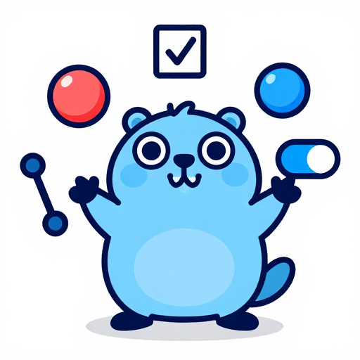

# Widgets



Example: [`examples/widgets`](../examples/widgets) (three tabs: input, lists, ranges).

Every widget has a constructor function that returns a description (`gowt.Option`): `gowt.Label(text, opts...)`, `gowt.Button(text, opts...)`. A description becomes a widget when it is passed to its parent: as a child of a container constructor (`gowt.VBox`, `gowt.Group`, `gowt.Split`, ...), to `app.Window(title, children...)` or to `Add(children...)` of a live container. Events, initial values and rx bindings are options too (see below), and data shared between widgets lives in `rx` state ([events.md](events.md)). For imperative work on a widget (filling a Table, `Pages.Show`, `Canvas.Redraw`) declare `var x *gowt.LabelView` and pass `gowt.Ref(&x)`, or run the code in `gowt.Init(func(x *gowt.LabelView) {...})`; both run once the widget and its children exist, `Ref` sets `x` for the code after the `Add` or `app.Window` call. The widget types carry a `View` suffix (`*gowt.LabelView`, `*gowt.TableView`, ...) and have plain Go methods: no `Get` prefix, `int` for sizes, `time.Time` for dates.

<br clear="right">

## Options

Options go last in the call. Some set a style that must be known at creation, the rest adjust the widget afterwards. A style option on a widget it does not apply to is reported to `App.OnError`; the "Options:" line of `go doc github.com/haiodo/gowt.Label` (and of every other constructor) lists what a widget takes.

| Option | Meaning |
|---|---|
| `Check()`, `Radio()`, `Toggle()` | button kind; `Check` also makes Table/Tree rows and ToolBar items checkable. `Toggle` stays pressed until clicked again (Wrap, Clip): macOS a push-on-push-off `NSButton`, GTK `GtkToggleButton`, Windows the WinUI ToggleButton with the accent fill while on |
| `Multiline()`, `Password()`, `ReadOnly()` | Text (and `ReadOnly` for Combo) |
| `Inset(x, y)`, `AutoGrow(minHeight, maxHeight)` | multi-line Text: space between text and edges (`x` both sides, `y` above and below, one pair as in AppKit); height that follows the wrapped lines between the two limits (0 is no maximum), shorter text centred vertically |
| `Border()`, `Flat()`, `Wrap()` | frame; flat tool bar; Label and StyledText text wrapped into lines, tool bar items wrapped into rows |
| `Vertical()` | Scale, Slider, Progress, Sash, Split orientation |
| `MultiSelect()` | List, Table, Tree |
| `Borderless()`, `Circle()` | push Button: no frame (an icon beside a field, + and - in a section header); round. A `Toggle` Button takes `Borderless` too: macOS the recessed scope-bar bezel (a frame under the pointer, a pressed-in fill while on), GTK `flat`, Windows Subtle. `Circle()` with `look.GlassButton()` is a glass circle on macOS 26, the paperclip of the iPad composer. Give a round button a square `Size`. Windows keeps the rectangle |
| `Primary()`, `Destructive()` | push Button: the main action of the window (also its default button, Enter presses it), and an action that deletes or discards. macOS: the accent default button and `hasDestructiveAction`; GTK: `suggested-action` and `destructive-action`; Windows: the WinUI accent fill for Primary, a standard button for Destructive. Together they are a red default button |
| `Small()` | Segmented and Button: the small control size of an inspector, macOS `NSControlSizeSmall` with its 11-point font, Windows and Linux the font smaller by the same ratio |
| `Momentary()` | Segmented: the segments are buttons that run `OnSelect` and do not stay selected |
| `Collapsed()`, `Trailing(children...)` | Disclosure: start folded; widgets at the right end of the header |
| `Disabled()`, `Tooltip(s)`, `Background(RGB)` | any widget |
| `AccessibleLabel(s)` | any widget: the name a screen reader says for a control with no text, an icon-only Button. macOS `accessibilityLabel`, Linux the ATK name, Windows nothing (`Accessible` is a stub) |
| `ID(id)` | any widget, a Panel or a Window: names it for the QA driver, which picks controls by it. Stored in the data key `gowt.id` in every build, it changes nothing on screen. Rows made by `Each` pass an id from their row data |
| `Gap(n)`, `Padding(n)` | containers: space between children and from the edge, see [windows-layouts.md](windows-layouts.md) |
| `Ref(&x)`, `Init(f)` | store the created widget in `x`; run `f` on it once it and its children exist |
| `OnClick(f)` | Button `func()`, Link `func(href string)` |
| `OnChange(f)` | Text, Combo, StyledText `func(string)`; Switch, Check/Radio/Toggle Button `func(bool)`; Scale, Slider, Spinner `func(int)`; DateTime `func(time.Time)` |
| `OnSelect(f)` | Combo, List, Table, Tabs, CTabs, Segmented `func(int)`; Tree `func(*Node)` |
| `OnActivate(f)` | Text `func()` (Enter); List, Table `func(int)`; Tree `func(*Node)` |
| `Hint(s)`, `Checked(b)`, `Selected(i)` | initial state: Text placeholder; Switch and Check/Radio/Toggle Button; Combo, List, Table, Tabs, CTabs, Segmented |
| `Value(v)` | initial value: string for Text, Combo, StyledText; int for Scale, Slider, Spinner, Progress; `time.Time` for DateTime |
| `Bind(state)` | two-way: `*rx.State[string]` Text, Combo; `[bool]` Switch, Check or Toggle Button, Disclosure expanded; `[int]` Scale, Slider, Spinner, Combo, List, Segmented index (Progress one way) |
| `BindText(r)`, `BindEnabled(r)`, `BindVisible(r)` | Label, Button, Link text; enabled and visible state of any widget, see [events.md](events.md) |
| `NoBorder()` | drops the frame of List, Table, Tree, and the one `Border()` gives a Text or StyledText (it wins over `Border()` in either order) |
| `NoBackground()` | StyledText paints no background of its own: a `look.SetMaterial` pane or a coloured panel under it shows through; selected text and `TextStyle` backgrounds are still drawn |
| `CellSelect()` | Tree selects only the node text instead of the whole row |
| `Search()` | Text as a search field with a magnifier icon and a clear button |
| `Grow()`, `GrowX()`, `GrowY()`, `Span(n)`, `Size(w, h)`, `Place(h, v)`, `Cell(GridCell)`, `Anchor(FormCell)` | position in the parent's layout, see [windows-layouts.md](windows-layouts.md) |
| `Right()`, `Center()` | Table column alignment |
| `Fit()` | Table and Tree column: as wide as the header and the widest cell, again after the rows change |
| `LineNumbers()` | StyledText: a line number gutter that scrolls with the text |
| `Fields(Field(label, control)...)` | a form: labels aligned the native way, see [Forms](#forms) |
| `Bottom()` | Tabs and CTabs: tabs below the pages |
| `Closable()` | CTabs tab with a close button |
| `AsTime()`, `AsCalendar()`, `DropDown()` | DateTime variants |
| `Simple()`, `Smooth()`, `Indeterminate()` | Combo list always shown; unsegmented progress; progress without a value |

## Catalog

| Widget | Constructor | Notes |
|---|---|---|
| Label | `Label(text)` | `SetText`, `SetImage` |
| Spacer, Separator | `Spacer()`, `Separator()` | an empty cell that takes the free space of a VBox, HBox or Grid row; a horizontal line (`Vertical()` for a vertical one). Both create a `*LabelView` |
| Switch | `Switch(text, opts...)` | on/off toggle; options `Checked`, `OnChange`, `Bind`; methods `Checked`, `SetChecked`, `SetText`, `OnChange(func(bool))`. A check box on every OS (SWT creates no NSSwitch or GtkSwitch) |
| Button | `Button(text, opts...)` | push by default; `Check()`/`Radio()`/`Toggle()`; `OnClick(f)`; `Checked`, `SetChecked`, `SetImage`, `OnClick` |
| Disclosure | `Disclosure(title, children...)` | collapsible inspector section: a header of a disclosure chevron, the title in `Type.BodyStrong` and the widgets of `Trailing(...)` at the right end, over a body of the children stacked as in a VBox (`Gap`, `Padding` apply to it), folded by a click on the chevron or the title. `Expanded`, `SetExpanded`, `OnChange(func(bool))`, `Add`; options `Collapsed`, `Trailing`, `OnChange`, `Bind` (bool). macOS an `NSButton` with the disclosure bezel, GTK a flat arrow button (`pan-end`/`pan-down`), Windows the WinUI expander chevron |
| Segmented | `Segmented([]Segment{...}, opts...)` | segments side by side, one selected (Fixed, Hug, Fill), or with `Momentary()` a row of buttons; a `Segment` has `Text`, `Image` and `Tooltip` (an icon-only segment is named to screen readers by its tooltip). The segments share the width equally, `GrowX()` stretches them. `Index` (-1 if none), `Select(i)` (-1 clears), `OnSelect(func(int))`; options `Selected`, `OnSelect`, `Bind` (int), `Small`, `Momentary`. macOS `NSSegmentedControl`, GTK toggle buttons joined as a `linked` box, Windows toggle buttons painted as one WinUI segmented control (a raised card with an accent pill on the selected segment) |
| Text | `Text()` | `Text`, `SetText`, `Append`, `Lines`, `TrimHead(keep)`, `ScrollToEnd`, `SetHint` (or the option `Hint`), `OnChange(func(string))`, `OnActivate(func())` (Enter); multi-line: `SetInset(x, y)`, `ContentHeight(width)` (height of the wrapped text at a width, inset included, one line at least), `SetAutoGrow(min, max)` |
| Link | `Link(html, opts...)` | text with `<a href="...">`; `OnClick(func(href string))` gets the href |
| Combo | `Combo(items)` | `Index` (-1 if none), `Items`, `Select`, `Text`, `OnSelect(func(int))`, `OnChange(func(string))` |
| List | `List(items)` | `Add`, `Remove`, `Clear`, `Index`, `Selected`, `Select(i...)`, `Deselect()`, `OnSelect`, `OnActivate` (double click) |
| Table | `Table()` | `Column(title, width, opts...)` (`Fit()` keeps it to the content; `FitColumns()` once), `Row(cells...)` returns `*TableRow` (`TextAt(col)`, `SetTextAt(col, s)`, `SetImageAt(col, img)`, `SetData`, `Data`, `SetChecked`), `RowAt(i)`, selection as for List, `ShowHeader`, `ShowLines`, `ShowRowLines`, `SetSort(col, dir)`, `CellAt(x, y)`, `OnCellClick`; `Column` also has `SetResizable` |
| Tree | `Tree()` | `Node(text)` on the tree and on a node; callbacks get `*Node` (`Text`, `SetExpanded`, `Children`, `SetData`, `Remove`); `Roots`, `Selected`, `Select(node)` (nil clears), `Deselect()`, `Clear`; `OnSelect`, `OnActivate`, `OnExpand`, `OnCollapse`. Columns as in Table: `Column(title, width, opts...)` returns the same `*Column` type (the first holds the tree), `ShowHeader`, `ShowRowLines`, `SetSort`, `CellAt`, `OnCellClick`; per-column cells `Node.TextAt(col)`, `SetTextAt`, `SetImageAt` |
| Scale, Slider, Spinner | `Scale(min, max, opts...)` | start value with the option `Value(n)` (default `min`); `Value`, `SetValue`, `OnChange(func(int))` |
| Progress | `Progress(max, opts...)` | option `Value(n)`; `SetValue`, `SetMax`, `Value` |
| DateTime | `DateTime()` | `Value`/`SetValue` as `time.Time`, `OnChange` |
| Group | `Group(title, children...)` | titled container, children stacked as in a VBox |
| Section | `Section(rows...)` | grouped "inset" card as in macOS System Settings; every child is a row (usually an `HBox` or `Grid`), with a separator line before every row but the first; `SectionView.Add` appends rows. See [theme-look.md](theme-look.md#finder-and-system-settings-look) |
| Tabs, CTabs | `Tabs(tabs...)`, `CTabs(tabs...)` | children are `Tab(title, children...)` pages (`Ref` gives the page `*Panel`; `TabsView.Add` appends; `Dispose` on the page removes the tab, and a closed CTabs tab disposes its page); `Select`, `Index`, `OnSelect`; CTabs adds `OnClose(func(index int) bool)` (false keeps the tab) |
| Pages | `Pages(pages...)` | one page at a time, no tabs: every child is a page (the first is shown), `Add` appends, `Show(i)`, `Current()`; `Dispose` on a page removes it and shows a neighbour |
| Split | `Split(panes...)` | children are the panes, any widgets in order; each pane fills its part, `SetWeights(...)` sets the relative sizes. A pane takes no placement options: `Grow`, `GrowX`, `GrowY` are accepted and change nothing, `Size`, `Span`, `Place` and the rest go to `App.OnError` |
| Scroll | `Scroll(children...)` | children stack in the scrolling area as in a VBox and fit; `ScrollView.Add` adds more and fits again; `Origin`, `SetOrigin(x, y)`; `OnScroll(func(x, y int))` after any scroll (wheel, trackpad and its momentum, scroll bars, `SetOrigin`), at most once a frame |
| ToolBar | `ToolBar()` | `Item(text, onClick)` returns a `*ToolItem` (call it after the `Add` that creates the tool bar); `Separator()` |
| CoolBar, Sash | `CoolBar(bands...)`, `Sash()` | each child of the cool bar becomes a band; `Sash.OnMove` |
| Canvas | `Canvas(onPaint)` | the callback's `g.Size()` is the drawable size in points at paint time (`CanvasView.Size()` is the same number outside the callback); see [graphics.md](graphics.md); `OnMouseDown`, `OnMouseUp`, `OnMouseMove` (`Mouse`: X, Y, Button, Count); `OnResize(func(w, h int))` runs after layout gave the canvas a new size and once for the first size known |
| StyledText | `StyledText(Scrollbars())` | `Text`, `SetText`, `Selection`, `Caret`, `Append`, `Lines`, `TrimHead(keep)`, `ScrollToEnd`, `Replace`, `SetStyle(start, length, TextStyle)`, `Styles`, `OnStyle(func(line string) []StyleSpan)`, `LineNumbers()` / `SetLineNumbers(bool)`, `NoBackground()`, `OnChange`, `OnSelect`, `OnCaret`. Offsets are runes; each call converts to UTF-16 (O(n)). Example: [`examples/styledtext`](../examples/styledtext) |

A List row has text only (`swt.List` has no item images). A row with an icon is a Table without columns, header and grid lines; in a `look.SetSidebar` sidebar it gets the List look ([theme-look.md](theme-look.md)), on macOS the selected row's text in the accent colour, and the first column's icon too when it is a template image (`NSImage isTemplate`), as AppKit does: `icons.Get` icons without `icons.Color` are templates on macOS; any other image, `ImageFromProvider` and `FromSVG` ones included, and the images of later columns keep their colours. `icons.Get` tints the icon for the theme at call time, so set the icons again in `App.OnThemeChange`. See `examples/sidebartable`:

```go
var files *gowt.TableView
w.Add(gowt.Table(gowt.NoBorder(), gowt.Ref(&files), gowt.Init(func(t *gowt.TableView) {
	t.ShowHeader(false)
	t.ShowLines(false)
	t.Row("a.cpuprofile").SetImageAt(0, icons.Get(app, "file"))
})))
app.OnThemeChange(func(bool) { files.RowAt(0).SetImageAt(0, icons.Get(app, "file")) })
```

All images of one Table or Tree, in every row and column, get the size of the first image it was given; this is SWT's model on every platform (macOS `Table.imageBounds`, Windows one image list per table, GTK one fixed cell size). On macOS a larger or smaller image is scaled into that box; on Linux `GetImageBounds` reports it (a 28x20 badge in column 1 after a 16x16 icon in column 0 gets 16-point-wide bounds). Images of different widths, such as count badges next to icons, therefore go onto transparent canvases of one size.

`Column.SetWidth` changes that column only: SWT turns AppKit's column autoresizing off, and the sidebar look restores the widths AppKit changes when it switches the style. On macOS a Table or Tree in a `look.SetSidebar` sidebar has the source-list style, which pads both row ends (31 points on macOS 26); its client area (`Unwrap().GetClientArea()`) leaves the padding out, so columns that add up to the client width fit the visible width.

## Forms

`gowt.Fields` is a two-column Grid of label | control rows. The labels are aligned as the OS does it: trailing, against the field, on macOS (System Settings, Finder dialogs); leading on Windows and GNOME. They are centred on the row of the control; `FieldTop()` puts a label at the top of a tall control.

```go
gowt.Fields(gowt.GrowX(), gowt.Gap(gowt.Spacing.MD),
	gowt.Field("Name", gowt.Text(gowt.GrowX())),
	gowt.Field("Notes", gowt.Text(gowt.Multiline(), gowt.GrowX(), gowt.Size(0, 80)), gowt.FieldTop()))
```

Options of `Field` after the control go to the label (`Foreground`, `Typeface`, `Tooltip`). A settings list of macOS 26 System Settings, with the label at the start and the control at the end of each row, is a `Section` of `HBox` rows instead.

## Primary and destructive buttons

`Button("Save", gowt.Primary())` is the default button of the window: Enter presses it and the system draws it as the prominent one. `Button("Delete", gowt.Destructive())` marks an action that deletes. They are the look of the system, not a colour you choose: macOS draws the default button in the accent colour and a destructive action with `hasDestructiveAction`; GTK adds `suggested-action` (accent fill) and `destructive-action` (red fill); on Windows gowt paints the WinUI accent fill (the system accent, 90% on hover, 80% pressed, text black or white by the accent's brightness) and, only together with `Primary`, the critical fill (C42B1C, FF99A4 in the dark theme); a lone `Destructive` stays a standard button there, as on macOS. The last `Primary` of a window is its default button. Both apply to push buttons only.

## Columns that fit

`t.Column("Subject", gowt.Scaled(200), gowt.Fit())` sizes the column to its header and its widest cell, now and after every `Row`, `Remove`, `Clear`, `Rows`, `Nodes`, expand and collapse (once per event-loop turn). The width argument is only the first width. `t.FitColumns()` does it once for every column. Every row is measured: with tens of thousands of rows call `Column.Pack` once after loading instead. macOS and Windows use the toolkit's autosize; on Linux gowt measures the texts with the control's font, since the toolkit's `Pack` gave only the header width there (cell padding 12 points, 24 per tree level, images and their 6 point gap included).

## Badges and chips

There is no badge widget, on purpose. None of the three systems has a native chip control to wrap (GNOME uses a Label with a CSS class, macOS has none, WinUI's `InfoBadge` is a notification dot), and one drawn by gowt would need its text width before layout, which the facade does not have: text can be measured only inside a paint callback. A pill is a small `Canvas` that fills itself into the size it gets:

```go
func pill(text string, w, h int, bg, fg gowt.RGB) gowt.Option {
	return gowt.Canvas(func(g *gowt.GC) {
		w, h := g.Size()
		g.SetFill(bg)
		g.FillOval(0, 0, h, h)
		g.FillOval(w-h, 0, h, h)
		g.FillRect(h/2, 0, w-h, h)
		g.SetColor(fg)
		tw, th := g.TextSize(text)
		g.Text(text, (w-tw)/2, (h-th)/2)
	}, gowt.Size(w, h), gowt.Typeface(gowt.Type.Caption))
}
```

Give it `Scaled` sizes. For a plain count next to a name, a `Label` with a `Foreground` and `Background` is enough; `App.SetBadge` is the Dock or taskbar badge, a different thing. The example is `kit.Pill` in `examples/apps/internal/kit`.

## Round images

`app.AvatarImage("AB", gowt.RGB{...}, 40)` makes a round image of 40 points: a disc with the initials in white. `app.CircleImage(img, 40)` crops the middle square of an image to a circle. Both draw again at every zoom of the display (`ImageFromProvider`), have an anti-aliased edge and are owned by the app like any `*gowt.Image`: use them as the image of a Label, a Button, a Table cell or a Tree node. `CircleImage` draws from `img`, so dispose `img` only after the copy is no longer shown.

## Any control

Every widget (`Window` and containers included) has these methods, which are also the methods of the `Widget` interface: `SetEnabled(v)` / `Enabled()` (children of a disabled container follow), `SetVisible(v)` / `Visible()` (in a Grid, VBox or HBox layout the hidden control gives up its cell and the parent is laid out again; `SetVisible(true)` clears that, and a placement option applied afterwards resets it), `SetFont(Font{Name, Size, Scale, Weight, Bold, Italic})` (empty Name and zero Size keep the current ones; with Size 0, `Scale` is a multiple of the system font size, `app.SystemFont()`; `Weight` is `Light`/`Regular`/`Medium`/`Semibold`/`Bold` or any 100..900 and overrides `Bold`, the system UI font gets a real weight on every OS, a named family gets the nearest face it has; controls given equal fonts share one native font, freed after its last user), `SetForeground(paint)`, `SetBackground(paint)` (an `RGB`, or an `Adaptive{Light, Dark}` that follows the system theme; on a container the labels and boxes inside show the background too; nil restores the default), `SetHeight(h)` (the height `Size` gave, 0 for the natural one; the parents are laid out on the next event-loop turn or at `App.Flush`), `SetSize(w, h)` (both hints, 0 for the natural value), `SetMaxHeight(h)` and the option `MaxHeight(h)` (below), `SetTooltip(s)`, `Focus()`, `Dispose()` (the parent is laid out again; a second call does nothing), `OnDispose(f)`, and the options `BindVisible(r)` / `BindEnabled(r)` that follow an rx value ([events.md](events.md)). The header font of Table and Tree is not reachable; use `Unwrap()`.

`Table.Batch(f)` and `Tree.Batch(f)` suspend drawing while `f` runs, so many row changes repaint once.

## Cell clicks

`Table.OnCellClick` and `Tree.OnCellClick` run on every mouse press with the row (or node), the column index from the item's per-column bounds, `Button` (SWT numbering: 1 left, 2 middle, 3 right), `Count` (2 on a double click) and the modifier keys `Ctrl`, `Shift`, `Alt`, `Cmd` (a macOS Ctrl-click is Button 1 with Ctrl), so a handler ignores what it does not need. The cell comes from a hit test, not from the selection, which may not have moved yet. `CellAt(x, y)` does the same for any point, e.g. a context menu; the expander arrow maps to its cell, but a point right of the last column has `Col` -1 (empty space is never a cell). `Tree` selects whole rows so that a click in any column finds its node.

## Logs in Text and StyledText

`Append(s)` adds at the end without `SetText`; `Lines()` counts lines; `TrimHead(keep)` deletes the oldest lines (`TrimHead(0)` clears; it works on a read-only view) (Text rewrites its content, so trim when `Lines()` exceeds a cap by a margin; StyledText deletes just the head); `ScrollToEnd()` follows the tail.

## Clipboard and drag and drop

`app.Clipboard()` returns the system clipboard (created on first use, disposed when `Run` returns): `Text`/`HTML`/`Files`/`Image` return `ok` or nil, `SetText`/`SetHTML`/`SetFiles`/`SetImage` return an `error` because a busy clipboard is routine on Windows. Images are owned by the App. UI thread only. Example: [`examples/clipboard`](../examples/clipboard).

`DragFrom(widget, Drag{Text: ..., Files: ..., Image: ...})` and `DropOn(widget, Drop{Text: ..., Files: ..., Image: ..., Over: ...})` make any widget a drag source or drop target; a control has at most one of each. Images dropped on a target are owned by the App. Custom transfers go through `Unwrap()` on the returned handle. Example: [`examples/dnd`](../examples/dnd). A plain drag (no key held) takes move if the source and the target both allow it, else copy, else link; a modifier key asks for another one. Checked with a real mouse, Tree to Tree and Tree to a canvas, on Linux (GTK 3, Xvfb) and Windows 11 arm64; not on macOS (see [facade.md](facade.md)). Tests drive a drag with `Element.DragTo`, see [qa.md](qa.md).

Items are not widgets: rows, nodes, tool items and tab pages come from their owner and are used right away.

Wrappers returned by `Row`, `Node` and the `Tree.On*` callbacks are fresh each call. Keep per-item state with `SetData`/`Data`, not in a map keyed by the wrapper.

## Selection

`Index()` is the first selected item (-1 for none) for Combo, List and Table; `Select(i)` selects one Combo item. List and Table also have `Selected()` (all selected), and their `Select(i...)` takes several indexes (none clears the selection). `Deselect()` on List, Table and Tree clears the selection and calls no `OnSelect`, as SWT's `deselectAll` sends no Selection; `Tree.Select(nil)` does the same. The option `Selected(i)` sets the initial selection of Combo, List, Table, Tabs and CTabs. Callbacks receive indexes. Tree callbacks receive `*Node`.

## Message input row

A chat composer is a glass capsule with a multi-line `Text` that grows with its lines:

```go
var row *gowt.Panel
gowt.HBox(gowt.Ref(&row), gowt.GrowX(), gowt.Padding(0),
    gowt.Text(gowt.Multiline(), gowt.GrowX(), gowt.Hint("Message"),
        gowt.Inset(14, 8), gowt.AutoGrow(40, 120)))
look.SetGlass(row, true)
look.SetGlassRadius(row, 20) // half the one-line height, as the iPad composer
```

- `AutoGrow(min, max)` sets the height to `ContentHeight(width)` between the limits, after every edit and every change of width; the text scrolls beyond `max`, and text shorter than `min` is centred. It gives the field the width its layout leaves over (use `GrowX`), not that of its longest line. The field needs a parent laid out by a VBox, HBox, Grid, Flow or Form, and the panel around it must not have a fixed height. Without `AutoGrow`, `ContentHeight(width)` with `SetHeight` does the same by hand (a field that follows its text only at certain moments).

### Capping the height of a Tree or Table

```go
gowt.VBox(
	gowt.Table(gowt.Grow(), gowt.Size(0, 120)),
	gowt.Tree(gowt.GrowX(), gowt.MaxHeight(300)))
```

- `MaxHeight(h)` / `SetMaxHeight(h)` (h in points, border included, 0 removes it) keeps the natural height of a widget at most `h`. A Tree or Table is as high as its rows, follows `Node`, `Row`, `Remove`, `Clear`, `SetExpanded` and the user's expand and collapse (the parents are laid out by themselves on the next event-loop turn, no `Relayout` is needed), and scrolls beyond `h`.
- In a VBox the limit is also what the other rows leave: the height of the VBox, less its padding and gaps, less the minimum of each growing row and the height of each other row. So with a window lower than the Table's 120 and the Tree's natural height together, the Table keeps 120 (`Size` is the minimum of a row that also has `Grow`/`GrowY`) and the Tree takes the rest and scrolls. A window resize and a `Relayout` of the VBox apply it again. Other parents (HBox, Grid, Flow, Form) take the plain limit.
- `SetHeight` and `SetSize` replace the limit. A height hint is a client height, as `Size` is: the border of a Scrollable comes on top (8 points on Linux, 21 on Windows with the horizontal bar); the limit counts it in.
- A relative limit (half of the sidebar) is not an option: the VBox rule above does that for the usual case; for another, call `SetMaxHeight` from the parent's resize handler.
- `Inset(x, y)` is one pair for both sides (AppKit has `textContainerInset` only); the hint moves with the text. Linux: the margins of the `GtkTextView`. Windows: `EM_SETRECT`, reset on every resize by the control (a listener sets it again); not run on a real system yet.
- `look.SetGlassRadius(row, r)`: a fixed radius while the field grows; `look.Capsule` follows half the shorter side and is for a row that stays one line.
- In a `look.SetGlass` panel on macOS the multi-line `Text` draws no background, so the glass is the field. Linux and Windows have no glass; the field keeps the native background.
- Linux: a text set before the first `Show` may wrap at a width wider than the field (a `GtkTextView` asks for the width of the longest line it first held); set it after `Show`.

## Known limits

- There is no widget font API yet; use `Unwrap()` ([swt-direct.md](swt-direct.md)).
- Table and Tree on macOS use the older cell-based NSTableView/NSOutlineView; the view-based kind (custom cell views) is not started, see [view-based-table.md](view-based-table.md).
